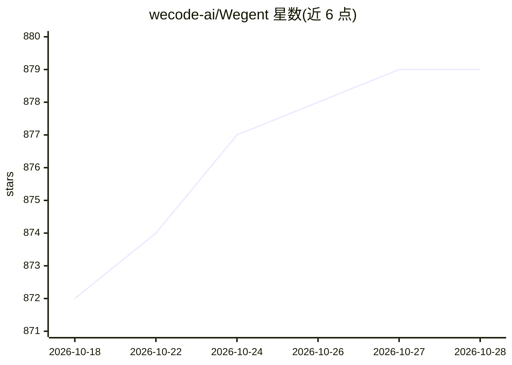

# wecode-ai/Wegent

⭐ 879 · TypeScript · Apache-2.0 · 推送 2026-10-28 · [GitHub](https://github.com/wecode-ai/Wegent) · [官网](https://wecode-ai.github.io/wegent-docs) · 组织维护 · 中文 README

**面向开发团队的自托管 AI 编码工作台（桌面+Web）**

开源的 AI 编码工作系统，含 Electron 桌面工作台（Wework）、浏览器端 Wegent Web 与可自托管的 Backend。桌面端按项目/任务组织本地编码工作：会话、工具活动、测试、变更文件与 diff 集中在一个视图；架构上由 Electron 承载窗口与系统层，DeepSeek Harness 作为插件运行时，Executor 管理任务并驱动 Codex 执行实际编码工作。支持项目空间共享任务板、远程设备执行、自动化队列与知识服务，通过安装包或 Docker 脚本部署，开发构建需 Node.js 20+ 与 pnpm。

## 筛选速览

| 维度 | 判定 | 备注 |
|---|---|---|
| AI 角色 | `ai-native` | 本体是模型或模型工具 |
| 许可风险 | `permissive` | Apache-2.0 |
| 部署形态 | `library` | 以包/库形式分发 |
| 模型依赖 | — | README 未给出锁定关系 |
| 硬件要求 | — | 无带数字的原话,不猜 |
| 安装摩擦 | `low` | 无编译、无系统依赖或容器化 |
| 成熟度 | — | 结构信号不足 |

## 能力要点

- 桌面工作台聚合会话、工具活动、测试、变更文件与 diff
- 任务可在本地、远程工作机或服务器管理的执行器上运行
- 自托管 Web 与 Backend 提供项目空间、权限、调度与知识服务
- 插件化运行时（DSH），产品 UI 由一组 DSH 插件组成

## 适用场景

- 在本地项目里让编码 agent 执行任务并审查代码变更
- 团队共享任务板、文件与执行设备推进项目
- 把重复性项目工作配置为自动化与执行队列

## 场景标签

`编码 Agent` · 领域:编码与开发

## 证据(README 行号)

> L14: Wegent includes a desktop workbench and a self-hostable web platform. Wegent Desktop works with local projects, fil
> L40: **The local coding experience built on Codex is the foundation of Wegent Desktop.** It works directly with the code
> L59: Wework is the Wegent desktop workbench. Electron owns desktop windows, system capabilities, and process management.

## 星数曲线

2026-10-18 872 → 2026-10-28 879（+7）

---
*卡片 v1 · prompt 1.4 · 生成 2026-10-21 · 置信度 low · 依据 README sha `5366259b5f62` · [字段定义](../../DATASET.md)*
