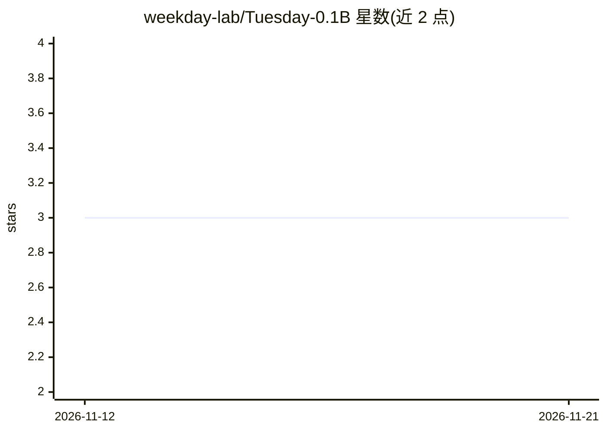

# weekday-lab/Tuesday-0.1B

⭐ 3 · Python · 推送 2026-11-12 · [GitHub](https://github.com/weekday-lab/Tuesday-0.1B) · [官网](https://modelscope.cn/studios/alimeituan/Tuesday-0.1B-V6) · 个人维护 · 中文 README

**从零预训练的 1.1 亿参数中文对话语言模型（V6 DPO 对齐版）**

Tuesday-0.1b V6 是一个从零训练、不依赖开源预训练权重的 110.9M 参数中文因果语言模型，采用 12 层 Pre-LayerNorm Transformer 解码器、32768 词表字节级 BPE、上下文 1024 token。同一底座派生基座、SFT 指令版、DPO 对齐版三个版本，仓库以标准 HuggingFace 格式提供全部权重、分词器与对话模板，需 trust_remote_code=True 加载。F32 权重 423MB，CPU 可运行。仅限个人学习研究，禁止商用。README 声明参数规模小，事实性知识薄弱，可能复读，未做 RLHF 级安全对齐。

## 筛选速览

| 维度 | 判定 | 备注 |
|---|---|---|
| AI 角色 | `ai-native` | 本体是模型或模型工具 |
| 许可风险 | `none` | — |
| 部署形态 | `library` | 以包/库形式分发 |
| 模型依赖 | — | README 未给出锁定关系 |
| 硬件要求 | — | 无带数字的原话,不猜 |
| 安装摩擦 | `low` | 无编译、无系统依赖或容器化 |
| 成熟度 | — | 结构信号不足 |

## 能力要点

- 110.9M 参数中文模型，从零训练，无需转换脚本直接以 HuggingFace 格式加载
- 基座/SFT/DPO 三个版本架构与词表一致，可互换使用
- CPU 即可运行，附带 test_model.py 四层自检脚本（支持 CI 闸门）
- 基于 BELLE 指令集与天工分片、THUCnews、维基中文等公开语料训练

## 适用场景

- 中文文本生成的学习与研究实验
- 作为小规模语言模型的继续预训练或微调起点
- 个人设备上无 GPU 的轻量推理体验

## 场景标签

`模型训练` `强化学习` · 领域:训练与推理

## 证据(README 行号)

> L16: Tuesday-0.1b 是一个 **1.1 亿参数的中文因果语言模型**，从零自研、不依赖任何开源预训练权重，
> L5: pipeline_tag: text-generation

## 星数曲线

2026-11-12 3 → 2026-11-21 3（+0）

---
*卡片 v1 · prompt 1.4 · 生成 2026-11-21 · 置信度 high · 依据 README sha `a20b85f7f803` · [字段定义](../../DATASET.md)*
