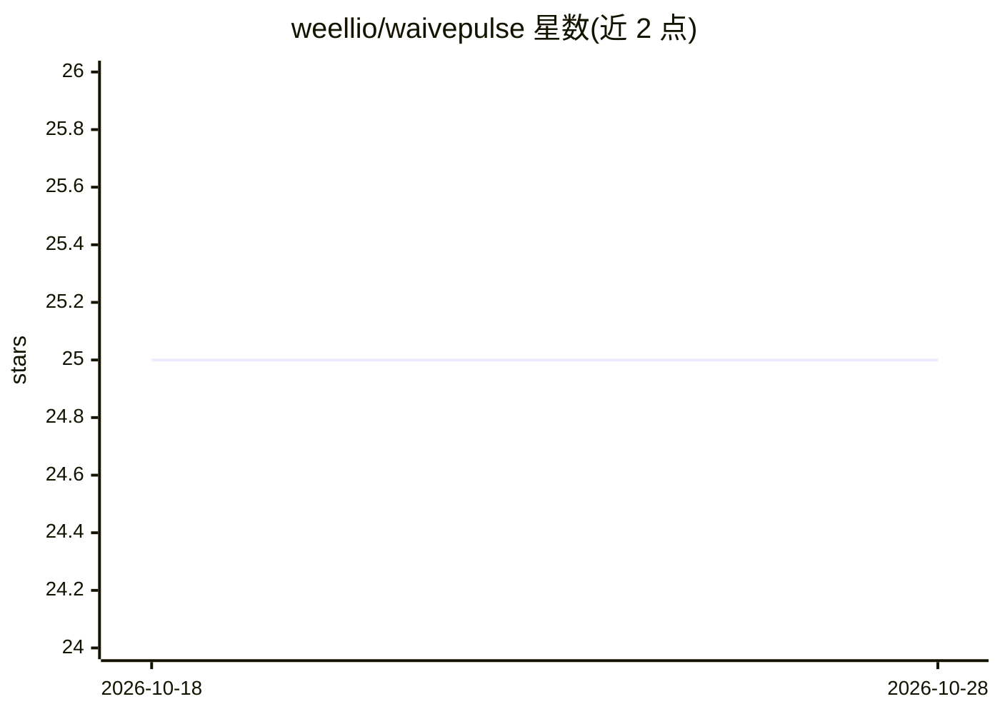

# weellio/waivepulse

⭐ 26 · JavaScript · NOASSERTION · 推送 2026-10-11 · [GitHub](https://github.com/weellio/waivepulse) · [官网](http://waivepulse.com) · 个人维护

**本地离线 AI 音乐生成与混音工作站：歌词加标签生成带人声歌曲**

在浏览器中运行的单机 AI 音乐工作室，整合五个工具页：用本地 Ollama 的 Llama 3.1 辅助写歌词；HeartMuLa 3B 模型根据歌词与流派标签生成带人声的完整 MP3；Demucs 在 GPU 上分出六条音轨并提供带母带链的混音界面；歌词同步的卡拉 OK 表演模式；浏览器内循环工作站。封面生成、视频导出、MIDI 导出、和声器等附加功能均在本地完成。要求 Windows 10/11 或 Linux，需 NVIDIA CUDA（macOS 不支持），歌词+生成流程在 12 GB 显存显卡上可运行，部分功能需额外 9.5 GB 显存或第二模型。许可为 MIT + Commons Clause。

## 筛选速览

| 维度 | 判定 | 备注 |
|---|---|---|
| AI 角色 | `ai-native` | 本体是模型或模型工具 |
| 许可风险 | `permissive` | NOASSERTION |
| 部署形态 | `library` | 以包/库形式分发 |
| 模型依赖 | local-ok | 支持本地模型 |
| 硬件要求 | `gpu-8g` | |
| 安装摩擦 | `medium` | 含编译或系统依赖之一 |
| 成熟度 | — | 结构信号不足 |

## 能力要点

- HeartMuLa 3B 从歌词与标签生成带人声 MP3，含种子控制与复现
- Demucs 六轨分离与含参量 EQ、母带链的 DAW 式混音界面
- 本地 Ollama Llama 3.1 流式生成歌词并自动检测安装
- 卡拉 OK 模式、循环工作站、封面/视频/MIDI 导出等配套工具

## 适用场景

- 写词并生成完整带人声歌曲，全程离线不走云服务
- 把生成或导入的歌曲分轨、混音并导出符合流媒体响度标准的成品
- 跟歌词同步练歌或录制歌词视频

## 场景标签

`AI 写作` · 领域:内容生成

## 证据(README 行号)

> L7: Write a song. Generate it. Mix it. Perform it. On your own GPU.
> L9: WAIvePulse is a local AI music studio that runs five connected tools in one browser. You write lyrics (or have Llama

## 星数曲线

2026-10-18 25 → 2026-10-28 25（+0）

---
*卡片 v1 · prompt 1.4 · 生成 2026-10-26 · 置信度 mid · 依据 README sha `5b3155b52d8f` · [字段定义](../../DATASET.md)*
