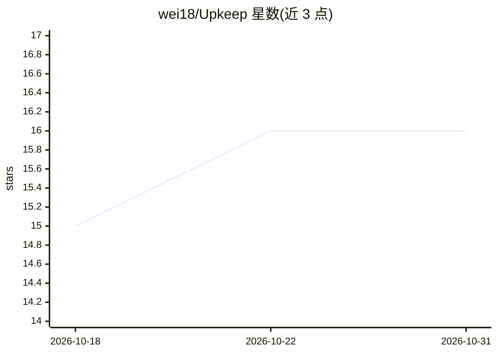

# wei18/Upkeep

⭐ 16 · TypeScript · MIT · 推送 2026-10-25 · [GitHub](https://github.com/wei18/Upkeep) · [官网](https://github.com/wei18/Upkeep/releases/latest) · 个人维护 · 中文 README

**AI 审计团队技能：检测仓库文档/规范/资源漂移**

以 Claude Code 插件/skill 形式安装的仓库审计工具：并行派发多个专注的 AI 审查者，检测过时文档、与代码不符的规范、孤立资源、约定违规与翻译不同步等语义漂移，输出带证据与严重度分级的 HTML 报告；CI 模式下还会 upsert 一个带 audit 标签的 GitHub 跟踪 issue。仅输出不修改文件。运行依赖已登录的 claude CLI（Pro/Max 订阅，无单独 API 计费）、Node 20+ 与 git；也可脱离 agent 以独立脚本运行。提供 7 个可配置的审查者，i18n 默认关闭。

## 筛选速览

| 维度 | 判定 | 备注 |
|---|---|---|
| AI 角色 | `ai-native` | 本体是模型或模型工具 |
| 许可风险 | `permissive` | MIT |
| 部署形态 | `library` | 以包/库形式分发 |
| 模型依赖 | — | README 未给出锁定关系 |
| 硬件要求 | — | 无带数字的原话,不猜 |
| 安装摩擦 | `low` | 无编译、无系统依赖或容器化 |
| 成熟度 | — | 结构信号不足 |

## 能力要点

- 并行派发专注 AI 审查者，检测全仓库语义漂移
- 仅输出不编辑文件：报告含证据与严重度分级
- CI 运行时 upsert 持久 GitHub 跟踪 issue 与 HTML 报告产物
- 7 个审查者（文档过时/死代码/规范偏差/图标/重复孤立文件/约定/i18n）可按仓库配置启停

## 适用场景

- 定期审计仓库，发现 README 与代码、规范与实现的不一致
- 在 CI 中按计划生成漂移报告并跟踪到 GitHub issue
- 对本地任意路径仓库按需运行审计

## 场景标签

`代码审查` · 领域:编码与开发

## 证据(README 行号)

> L7: **An AI audit crew for your repo, installed as a skill.** Upkeep dispatches focused AI reviewers in parallel to catc
> L36: - Scans a repository and dispatches a team of **focused AI reviewers** in parallel.
> L37: - Catches stale docs that drifted from code, specs that no longer match implementation, duplicate or orphaned files

## 星数曲线

2026-10-18 15 → 2026-10-31 16（+1）

---
*卡片 v1 · prompt 1.4 · 生成 2026-10-30 · 置信度 high · 依据 README sha `59fc408eea56` · [字段定义](../../DATASET.md)*
