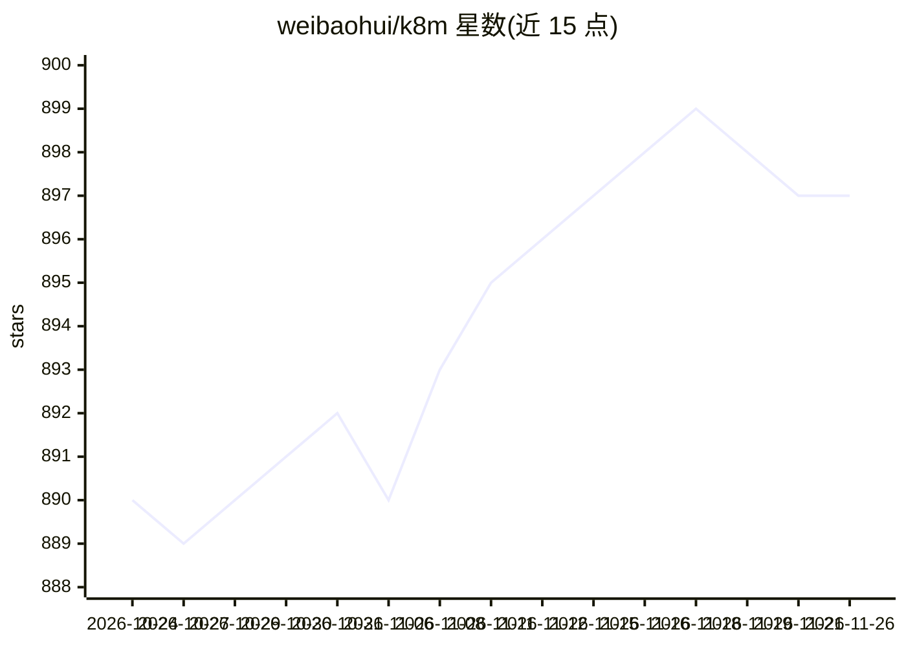

# weibaohui/k8m

⭐ 897 · Go · MIT · 推送 2026-11-07 · [GitHub](https://github.com/weibaohui/k8m) · [官网](https://github.com/weibaohui/k8m) · 个人维护 · 中文 README

**AI 驱动的轻量级 Kubernetes 管理控制台，辅助集群运维**

基于 Go 与百度 AMIS 构建的单文件 Kubernetes 管理控制台，提供多集群接入、用户/用户组授权、Pod 文件与日志管理、CRD 管理、Helm 应用安装、定时巡检与 Event 转发等集群管理能力。AI 部分包括划词解释、YAML 属性翻译、日志解读、命令推荐及内置 49 种 k8s MCP 工具；AI 功能需自行配置模型 API Key，不内置模型。提供跨平台二进制、docker-compose 与 kubectl 部署方式。

## 筛选速览

| 维度 | 判定 | 备注 |
|---|---|---|
| AI 角色 | `ai-enhanced` | 去掉 AI 部分产品仍成立 |
| 许可风险 | `permissive` | MIT |
| 部署形态 | `self-host` | docker 或自建部署 |
| 模型依赖 | local-ok | 支持本地模型 |
| 硬件要求 | — | 无带数字的原话,不猜 |
| 安装摩擦 | `low` | 无编译、无系统依赖或容器化 |
| 成熟度 | — | 结构信号不足 |

## 能力要点

- 集成 49 种 k8s 多集群 MCP 工具，可作为 MCP Server 供其他大模型软件调用
- MCP 调用权限与多集群管理权限打通，按使用者权限执行
- 单可执行文件部署，兼容 Linux/macOS/Windows 与 x86/ARM
- 定时巡检与 Event 转发支持推送钉钉、微信、飞书及自定义 webhook

## 适用场景

- 在控制台中管理多个 Kubernetes 集群与用户授权
- 通过大模型解读集群日志、Describe 信息并推荐运维命令
- 把集群巡检结果与 Event 汇总推送到团队群

## 场景标签

 · 领域:云原生/Kubernetes 运维工具

## 证据(README 行号)

> L19: **k8m** 是一款AI驱动的 Mini Kubernetes AI Dashboard 轻量级控制台工具，专为简化集群管理设计。它基于 AMIS 构建，并通过 [
> L20: `kom`](https://github.com/weibaohui/kom) 作为 Kubernetes API 客户端，**k8m** 支持接入您自己的大模型（包括ollama等私有化部署）。AI功能需自行配置模型API K
> L52: - **MCP集成**:可视化管理MCP，实现大模型调用Tools，内置k8s多集群MCP工具49种，可组合实现超百种集群操作，可作为MCP Server

## 星数曲线

2026-10-24 890 → 2026-11-26 897（+7）

---
*卡片 v1 · prompt 1.4 · 生成 2026-11-25 · 置信度 high · 依据 README sha `a21af168189b` · [字段定义](../../DATASET.md)*
