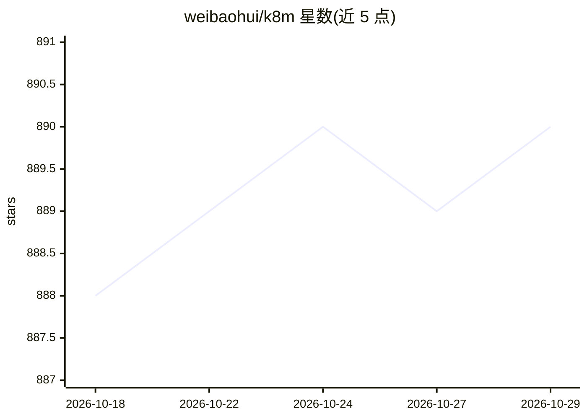

# weibaohui/k8m

⭐ 890 · Go · MIT · 推送 2026-10-17 · [GitHub](https://github.com/weibaohui/k8m) · [官网](https://github.com/weibaohui/k8m) · 个人维护 · 中文 README

**AI 驱动的轻量级 Kubernetes 多集群管理控制台**

用 Go 后端与百度 AMIS 前端构建的单文件 Kubernetes 控制台，面向开发者和运维人员。提供多集群管理（支持标准 k8s、EKS、k3s、kind、k0s）、用户/用户组多集群权限管理、Pod 文件与日志管理、CRD/Helm 管理、集群巡检与 Event 转发（可 AI 总结）。AI 部分内置 Qwen2.5-Coder-7B 模型，支持接入私有化大模型（含 Ollama），集成 MCP（内置 49 种 k8s MCP 工具，可作为 MCP Server）及 MCP 调用权限与集群权限打通。支持多数据库（SQLite/MySQL/PostgreSQL），提供 docker-compose 与 k8s 内部署方式。

## 筛选速览

| 维度 | 判定 | 备注 |
|---|---|---|
| AI 角色 | `ai-ecosystem` | LLM/agent 周边工具 |
| 许可风险 | `permissive` | MIT |
| 部署形态 | `self-host` | docker 或自建部署 |
| 模型依赖 | local-ok | 支持本地模型 |
| 硬件要求 | — | 无带数字的原话,不猜 |
| 安装摩擦 | `low` | 无编译、无系统依赖或容器化 |
| 成熟度 | — | 结构信号不足 |

## 能力要点

- 内置 Qwen2.5-Coder-7B，支持私有化大模型接入（含 Ollama）
- MCP 集成：内置 49 种 k8s 多集群 MCP 工具，可作为 MCP Server 供其他大模型软件使用
- 多集群管理与权限体系，MCP 调用权限与用户集群权限打通
- 单文件可执行部署，多平台多架构，支持 SQLite/MySQL/PostgreSQL

## 适用场景

- 用一个轻量控制台管理多个 Kubernetes 集群
- 让大模型通过 MCP 执行集群操作并按用户权限管控
- 集群巡检与 Event 转发到钉钉/微信/飞书并做 AI 总结

## 场景标签

 · 领域:云原生/DevOps 工具

## 证据(README 行号)

> L19: **k8m** 是一款AI驱动的 Mini Kubernetes AI Dashboard 轻量级控制台工具，专为简化集群管理设计。它基于 AMIS 构建，并通过 [
> L54: - **MCP集成**:可视化管理MCP，实现大模型调用Tools，内置k8s多集群MCP工具49种，可组合实现超百种集群操作，可作为MCP Server
> L56: - **MCP权限打通**:多集群管理权限与MCP大模型调用权限打通，一句话概述：谁使用大模型，就用谁的权限执行MCP。安全使用，无后顾之忧，避免操作越权。

## 星数曲线

2026-10-18 888 → 2026-10-29 890（+2）

---
*卡片 v1 · prompt 1.4 · 生成 2026-10-21 · 置信度 high · 依据 README sha `c188b27952c7` · [字段定义](../../DATASET.md)*
