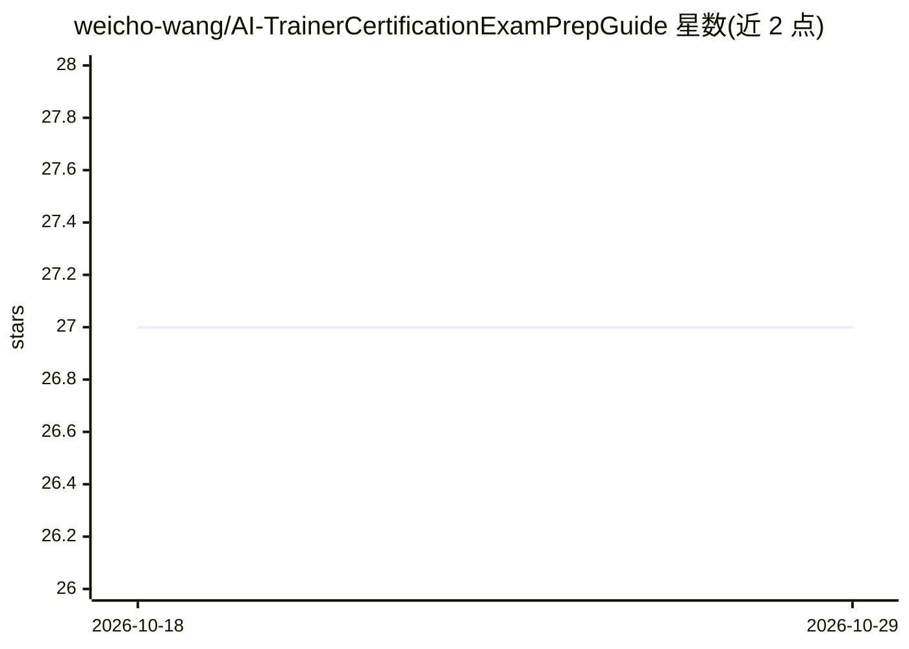

# weicho-wang/AI-TrainerCertificationExamPrepGuide

⭐ — · [GitHub]() · 个人维护 · 中文 README

**人工智能训练师认证考试的开源备考教程书**

面向准备人工智能训练师认证考试的新手读者，提供开源免费教程，内容分为基础概念讲解、算法原理与编程实例等部分，附配套视频教程讲解编程环境搭建，并提供全套代码便于调试。以简体中文、繁体中文、英文多语言版本维护，内容按 CC BY-NC-SA 4.0 许可发布，仍在持续更新中，接受社区贡献。

## 筛选速览

| 维度 | 判定 | 备注 |
|---|---|---|
| AI 角色 | `ai-knowledge` | 知识聚合/清单类 |
| 许可风险 | `none` | — |
| 部署形态 | `None` |  |
| 模型依赖 | — | README 未给出锁定关系 |
| 硬件要求 | — | 无带数字的原话,不猜 |
| 安装摩擦 | `low` | 无编译、无系统依赖或容器化 |
| 成熟度 | — | 结构信号不足 |

## 能力要点

- 覆盖基础概念、算法原理与编程实例的备考教程结构
- 配套视频教程讲解编程环境搭建
- 提供全套代码便于调试
- 提供简体中文/繁体中文/英文多语言版本

## 适用场景

- 准备人工智能训练师认证考试的系统学习
- 初学者入门人工智能基础概念与编程
- 查阅配套代码与视频进行动手练习

## 场景标签

`教程课程` · 领域:学习与行业

## 证据(README 行号)

> L11: 本项目旨在打造一本开源免费、新手友好的**人工智能训练师**备考教程。
> L13: - 基础概念详细讲解，方便初学者快速入门，不被术语所困扰。

## 星数曲线

2026-10-18 27 → 2026-10-29 27（+0）

---
*卡片 v1 · prompt 1.4 · 生成 2026-10-26 · 置信度 high · 依据 README sha `2b55248f1cac` · [字段定义](../../DATASET.md)*
