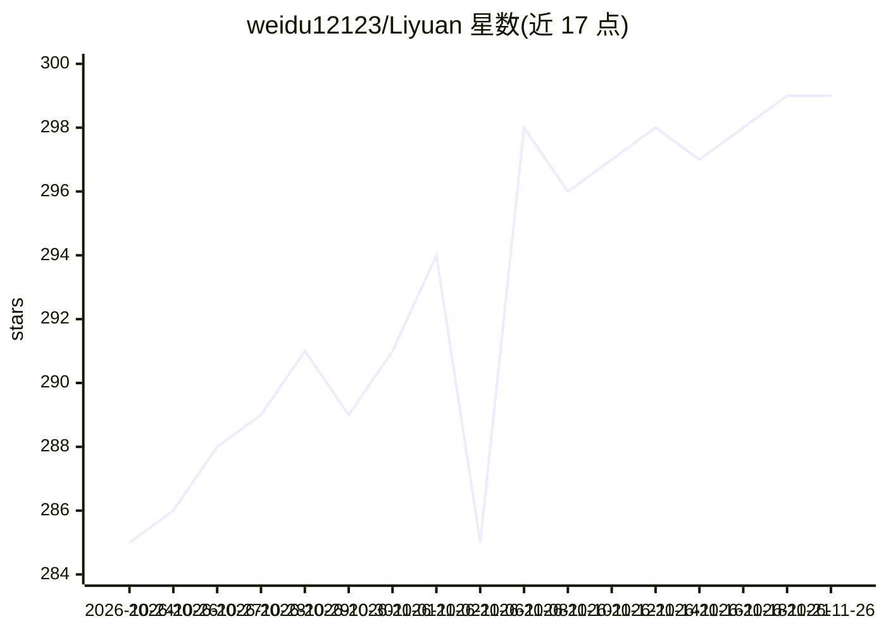

# weidu12123/Liyuan

⭐ 299 · TypeScript · NOASSERTION · 推送 2026-11-25 · [GitHub](https://github.com/weidu12123/Liyuan) · 个人维护 · 中文 README

**基于 pi 的 AI 角色扮演 Agent 应用：用编码 Agent 原语做 RP 前端**

以 RP Agent 为主体的角色扮演应用，把编码 Agent 原语映射为 RP 机制：角色卡即独立工作区、定向文本修订、lorebook 按需检索、故事分支回滚、叙事压缩、跨会话卡片记忆、决策卡交互。支持 Tavern/Character Card V2/V3 格式互通，数据以 JSON/Markdown 明文本地存储。需 Node.js ≥22 与 OpenAI 兼容 API key，本地脚本启动或 Docker 部署，端口默认无鉴权。

## 筛选速览

| 维度 | 判定 | 备注 |
|---|---|---|
| AI 角色 | `ai-native` | 本体是模型或模型工具 |
| 许可风险 | `none` | NOASSERTION |
| 部署形态 | `self-host` | docker 或自建部署 |
| 模型依赖 | — | README 未给出锁定关系 |
| 硬件要求 | — | 无带数字的原话,不猜 |
| 安装摩擦 | `low` | 无编译、无系统依赖或容器化 |
| 成熟度 | — | 结构信号不足 |

## 能力要点

- 编码 Agent 原语映射为 RP 机制（工作区/补丁/检索/回滚/压缩）
- 实时状态台账与角色花名册，防止设定漂移
- 卡片级跨会话记忆与物理遗忘机制
- 兼容 Tavern / Character Card V2 & V3 格式与 lorebook

## 适用场景

- 长篇角色扮演中管理多角色设定与状态一致性
- 复制角色卡文件夹在不同机器间迁移会话与记忆
- 自建角色卡并使用自定义前端脚本共创剧情

## 场景标签

`聊天机器人` · 领域:对话与助手

## 证据(README 行号)

> L5: **An RP Agent built on pi, bringing coding agent superpowers to role-playing.**
> L13: **Liyuan** (梨园) is a next-generation Role-Play Agent built on top of pi. By reimagining coding agent primitives for
> L62: - Any OpenAI-compatible API key (e.g., DeepSeek, OpenAI, Claude via proxy, etc.)

## 星数曲线

2026-10-24 285 → 2026-11-26 299（+14）

---
*卡片 v1 · prompt 1.4 · 生成 2026-11-25 · 置信度 high · 依据 README sha `92cb65c5a20c` · [字段定义](../../DATASET.md)*
