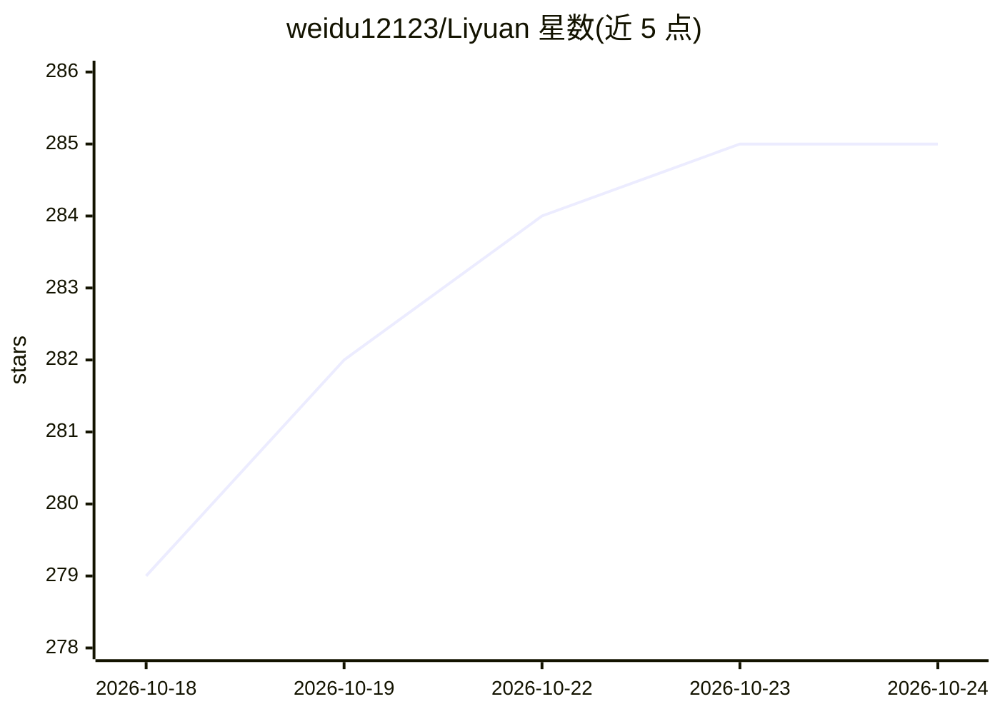

# weidu12123/Liyuan

⭐ 285 · TypeScript · NOASSERTION · 推送 2026-10-16 · [GitHub](https://github.com/weidu12123/Liyuan) · 个人维护 · 中文 README

**面向角色扮演用户的 RP Agent 应用，将编码 agent 机制引入叙事**

基于 pi agent 框架构建的 AI 角色扮演应用，供终端用户进行沉浸式故事创作。核心机制把编码 agent 原语映射到 RP 场景：每张角色卡为独立工作区，支持按需世界观检索、叙事压缩、状态账本防设定漂移、跨会话记忆与物理遗忘、非破坏性剧情分支回滚。兼容 Tavern 角色卡 V2/V3 格式，数据以纯文本 JSON/Markdown 本地存储。要求 Node.js ≥ 22 与任意 OpenAI 兼容 API key，提供脚本与 Docker Compose 两种部署方式，采用 PolyForm Noncommercial 许可，商业使用需作者授权。

## 筛选速览

| 维度 | 判定 | 备注 |
|---|---|---|
| AI 角色 | `ai-native` | 本体是模型或模型工具 |
| 许可风险 | `none` | NOASSERTION |
| 部署形态 | `self-host` | docker 或自建部署 |
| 模型依赖 | — | README 未给出锁定关系 |
| 硬件要求 | — | 无带数字的原话,不猜 |
| 安装摩擦 | `low` | 无编译、无系统依赖或容器化 |
| 成熟度 | — | 结构信号不足 |

## 能力要点

- 每张角色卡为独立可移植工作区（会话/状态/记忆自包含）
- 叙事压缩、按需 lorebook 检索与状态账本防设定漂移
- 跨会话卡级记忆与删除会话触发物理遗忘
- 兼容 Tavern 角色卡 V2/V3、lorebook 与聊天记录格式

## 适用场景

- 进行长篇角色扮演且需要设定一致性与记忆管理
- 与 AI 共同创作和调试角色卡
- 在不同机器间迁移角色卡与剧情进度

## 场景标签

 · 领域:AI 角色扮演/娱乐应用

## 证据(README 行号)

> L5: **An RP Agent built on pi, bringing coding agent superpowers to role-playing.**
> L13: **Liyuan** (梨园) is a next-generation Role-Play Agent built on top of pi. By reimagining coding agent primitives for
> L62: - Any OpenAI-compatible API key (e.g., DeepSeek, OpenAI, Claude via proxy, etc.)

## 星数曲线

2026-10-18 279 → 2026-10-24 285（+6）

---
*卡片 v1 · prompt 1.4 · 生成 2026-10-22 · 置信度 high · 依据 README sha `b070e4167d23` · [字段定义](../../DATASET.md)*
