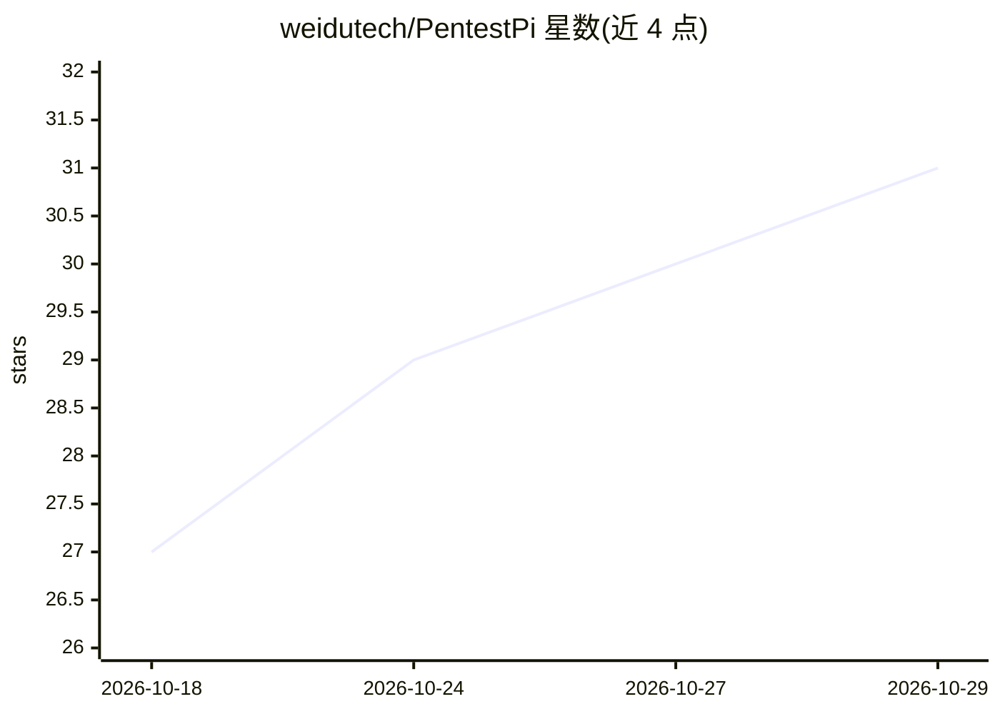

# weidutech/PentestPi

⭐ 31 · Python · Apache-2.0 · 推送 2026-09-09 · [GitHub](https://github.com/weidutech/PentestPi) · 组织维护 · 中文 README

**给安全研究者的自主渗透测试 AI Agent 框架**

构建在 Pi 通用 Agent 底座之上的自主渗透测试系统，面向企业红队、CTF 竞赛与安全基准评测。采用单 Agent 全流程贯穿架构，将攻防状态以 F/H/E/C/N/R 六要素持久化到 Markdown 状态文件（State v1 SPEC，附语法校验器），上下文压缩前拦截同步防凭据丢失；配备 Observer 战术轨迹看板、HTTP 流量 Sidecar 归档与 curl 重放导出、外置战术手册按需挂载；内置离线工具与字典。运行需 Linux/macOS/WSL2、Node.js≥18、Python≥3.10 与 Pi 命令行环境。仅限书面授权场景使用。

## 筛选速览

| 维度 | 判定 | 备注 |
|---|---|---|
| AI 角色 | `ai-ecosystem` | LLM/agent 周边工具 |
| 许可风险 | `permissive` | Apache-2.0 |
| 部署形态 | `None` |  |
| 模型依赖 | — | README 未给出锁定关系 |
| 硬件要求 | — | 无带数字的原话,不猜 |
| 安装摩擦 | `low` | 无编译、无系统依赖或容器化 |
| 成熟度 | — | 结构信号不足 |

## 能力要点

- State v1 单文件状态持久化（F/H/E/C/N/R 六要素）与语法校验器
- 上下文压缩前生命周期拦截，保障长任务证据与凭据不丢失
- 双维可观测：30 秒增量战术轨迹看板 + 完整 HTTP 流量归档与 curl 重放
- 外置战术经验手册（playbooks）自主/自动双挂载，按需加载零 Token 污染

## 适用场景

- 红队自动化侦察与渗透测试任务执行
- 高难度 CTF 竞赛与安全基准（如 TSecBench）评测
- 长时渗透任务的态势留存、中断恢复与人工接力
- 以 run_mission.sh 在 CI/CD 场景非交互执行测试任务

## 场景标签

`网络安全` `Agent 框架` · 领域:Agent 开发

## 证据(README 行号)

> L20: > **English Overview**: **PentestPi** is a production-grade autonomous penetration testing AI agent framework built
> L29: **PentestPi** 是一套构建在 Pi 通用 Agent 底座之上的**专业级自主渗透测试系统**。它专为实战攻防、红队自动化侦察、高难度 CTF 与安全基准评测（如 TSecBench）设计。
> L96: ### 1. 执行底座 (Base Engine)

## 星数曲线

2026-10-18 27 → 2026-10-29 31（+4）

---
*卡片 v1 · prompt 1.4 · 生成 2026-10-26 · 置信度 high · 依据 README sha `9310c0b2b283` · [字段定义](../../DATASET.md)*
