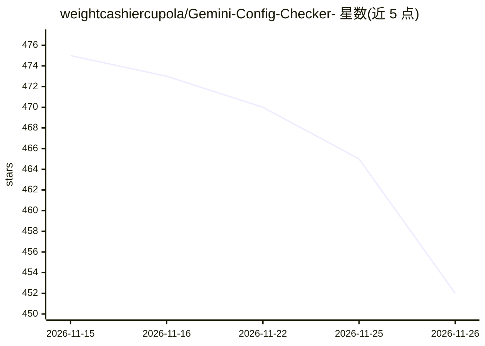

# weightcashiercupola/Gemini-Config-Checker-

⭐ 452 · Makefile · Apache-2.0 · 推送 2026-11-15 · [GitHub](https://github.com/weightcashiercupola/Gemini-Config-Checker-) · 个人维护

**检测代理配置能否访问 Google AI Studio/Gemini 的跨平台工具**

代理配置批量检测工具：逐一测试 vless/vmess/trojan/ss 等配置能否真正进入 Google AI Studio 与 Gemini。核心机制是以已登录 Google 账号的浏览器实例读取 Google 的实际区域判定（约 20–40 秒/条），而非仅做连通性探测；Simple 模式直接测试自有配置，Advanced 模式在可用基础配置后串联免费配置以更换出口 IP。内置 anti-DPI 配置（TLS ClientHello 分片等）应对深度包检测网络。桌面版支持 Windows/macOS/Linux，Android APK 仅连通性模式。版本 0.1.0，早期预发布，仅 Windows 经过实机验证。

## 筛选速览

| 维度 | 判定 | 备注 |
|---|---|---|
| AI 角色 | `ai-ecosystem` | LLM/agent 周边工具 |
| 许可风险 | `permissive` | Apache-2.0 |
| 部署形态 | `desktop` | 安装包/桌面程序 |
| 模型依赖 | — | README 未给出锁定关系 |
| 硬件要求 | — | 无带数字的原话,不猜 |
| 安装摩擦 | `medium` | 含编译或系统依赖之一 |
| 成熟度 | `idea` | |

## 能力要点

- 以已登录 Google 账号的浏览器读取区域判定，区分『可达』与『真正可用』
- Simple/Advanced 双模式，Advanced 支持基础配置串联免费配置更换出口
- 内置可编辑的 anti-DPI 配置（Finalmask 分片、指纹、ALPN、密码套件）
- Windows/macOS/Linux 桌面版、Android APK 与本地 Web 服务器多种形态，发布附 SHA256 校验

## 适用场景

- 批量测试手头代理配置哪些能真正打开 AI Studio/Gemini
- 依赖某配置前先验证其出口是否被 Google 区域封锁
- 在深度包检测网络中测试带 anti-DPI 配置的 Cloudflare 链路

## 场景标签

 · 领域:网络工具/代理检测

## 证据(README 行号)

> L11: Find proxy configs that actually get you into **Google AI Studio and Gemini**, by testing each one the way a person
> L50: Google decides region availability **per signed-in account, after the page has loaded**. A plain HTTP request (even

## 星数曲线

2026-11-15 475 → 2026-11-26 452（-23）

---
*卡片 v1 · prompt 1.4 · 生成 2026-11-17 · 置信度 mid · 依据 README sha `846e83cebb20` · [字段定义](../../DATASET.md)*
