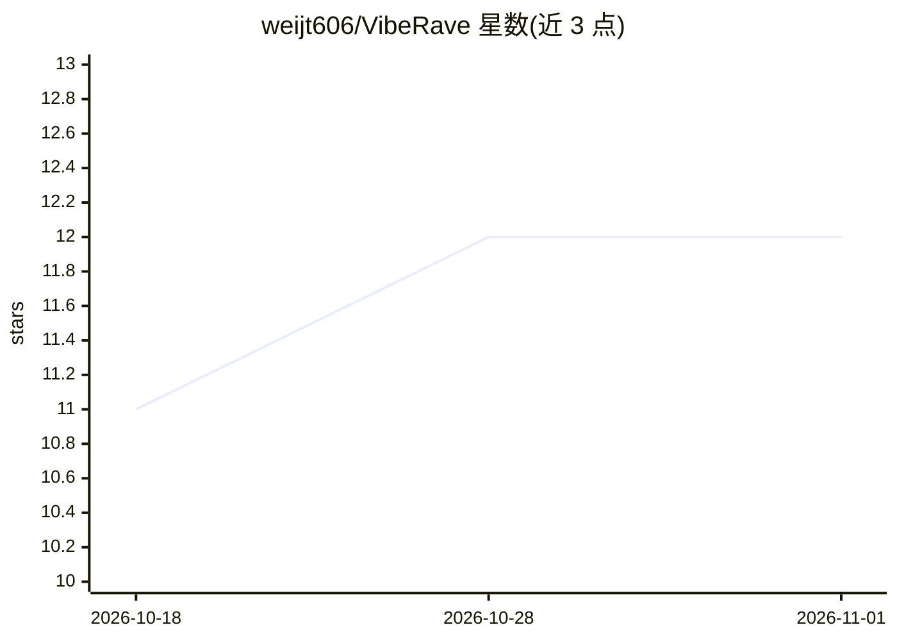

# weijt606/VibeRave

⭐ 12 · JavaScript · AGPL-3.0 · 推送 2026-10-18 · [GitHub](https://github.com/weijt606/VibeRave) · 个人维护 · 中文 README

**语音/文字驱动的 Strudel 多模态现场音乐实时编程引擎**

Strudel 的分支，在原 live coding 环境之上叠加多模态 agent 回路：按住按键语音（经 STT）、打字或点击预设指令均可输入，统一进入 LLM 生成 Strudel 代码并热交换当前播放的模式，音频调度器保持节拍不中断。面向现场演出者与音乐 live coding 用户。STT 可切换 whisper/vosk/OpenAI 兼容 API（含 DashScope 原生通道），LLM 可用任意 OpenAI 兼容端点或本地 Ollama，全栈可离线免费运行。提供多轨、11 种可视化、命令队列与 lite/full 两种安装档位。AGPL-3.0。

## 筛选速览

| 维度 | 判定 | 备注 |
|---|---|---|
| AI 角色 | `ai-native` | 本体是模型或模型工具 |
| 许可风险 | `viral` | AGPL-3.0 |
| 部署形态 | `library` | 以包/库形式分发 |
| 模型依赖 | local-ok | 支持本地模型 |
| 硬件要求 | — | 无带数字的原话,不猜 |
| 安装摩擦 | `medium` | 含编译或系统依赖之一 |
| 成熟度 | — | 结构信号不足 |

## 能力要点

- 语音/文字/预设指令三路输入接入同一 LLM agent 回路
- 生成代码热交换播放中的模式，节拍不中断
- STT 三后端（whisper/vosk/OpenAI 兼容 API，含 DashScope 原生）按请求切换
- LLM 可选 OpenAI 兼容 API 或本地 Ollama，无 API key 也能运行

## 适用场景

- 演出或创作时用说话快速迭代电子音乐模式
- 用精确文字指令微调音色与效果参数
- 纯本地离线运行语音驱动的音乐 live coding

## 场景标签

`代码生成` · 领域:编码与开发

## 证据(README 行号)

> L25: VibeRave is a fork of Strudel that adds a multimodal
> L34:             ├─ 🎙  voice  →  STT (whisper · vosk · any OpenAI-compat /audio API)
> L55: - **Pluggable LLM** — `api` (any OpenAI-compatible Chat Completions endpoint)

## 星数曲线

2026-10-18 11 → 2026-11-01 12（+1）

---
*卡片 v1 · prompt 1.4 · 生成 2026-10-31 · 置信度 high · 依据 README sha `1b3619782c3d` · [字段定义](../../DATASET.md)*
