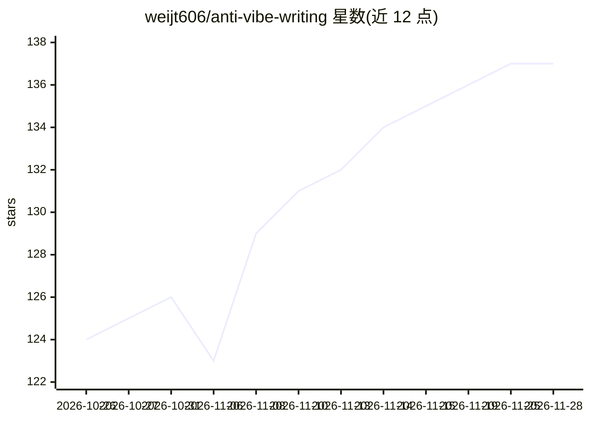

# weijt606/anti-vibe-writing

⭐ 137 · Shell · MIT · 推送 2026-11-15 · [GitHub](https://github.com/weijt606/anti-vibe-writing) · 个人维护 · 中文 README

**给 agent 用的去 AI 味改写技能，支持中英文**

以 SKILL.md 加参考规则文件形式分发的写作技能，供 Claude Code、Codex 等可读取文件或接受指令的 agent 加载，对草稿执行去 AI 味的改写终稿：移除模板化措辞、咨询腔、过多 markdown 结构、em-dash 及 oaicite/turn0search0 等模型残留标记。默认 clean 模式外提供 human-texture 模式、基于样本的 learning mode，以及推文/微博/博客等场景预设。安装方式为 Claude Code 插件、gh skill install 或手动放置规则文件。

## 筛选速览

| 维度 | 判定 | 备注 |
|---|---|---|
| AI 角色 | `ai-ecosystem` | LLM/agent 周边工具 |
| 许可风险 | `permissive` | MIT |
| 部署形态 | `None` |  |
| 模型依赖 | — | README 未给出锁定关系 |
| 硬件要求 | — | 无带数字的原话,不猜 |
| 安装摩擦 | `low` | 无编译、无系统依赖或容器化 |
| 成熟度 | — | 结构信号不足 |

## 能力要点

- 以纯 markdown 规则文件实现，不绑定特定 agent
- 默认 clean、human-texture、learning 三种模式及五类场景预设
- 针对中文的翻译腔与 AI 套话模式（赋能/打通、三段排比等）
- 支持 Claude Code 插件市场与 gh skill install 两种安装途径

## 适用场景

- 改写 AI 起草的 X/微博中文帖子，去除机器感
- 清理博客、公众号、newsletter 草稿中的 AI 残留标记
- 整理 README、产品文档与落地页文案

## 场景标签

`AI 写作` · 领域:内容生成

## 证据(README 行号)

> L14: An agent writing skill that removes the AI-generated feel from documents. Works in English and Chinese, with option
> L29: At its core this is just a set of markdown rules (`SKILL.md` + `references/` + `assets/`), not tied to any one agen

## 星数曲线

2026-10-26 124 → 2026-11-28 137（+13）

---
*卡片 v1 · prompt 1.4 · 生成 2026-11-28 · 置信度 high · 依据 README sha `4fef2945eac5` · [字段定义](../../DATASET.md)*
