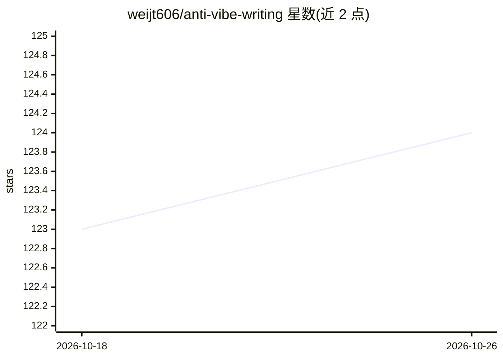

# weijt606/anti-vibe-writing

⭐ 124 · MIT · 推送 2026-08-08 · [GitHub](https://github.com/weijt606/anti-vibe-writing) · 个人维护 · 中文 README

**给 agent 用户的写作技能：清除文稿中的 AI 腔与模板痕迹**

一组以 markdown 规则形式提供（SKILL.md + references/ + assets/）的 agent 写作技能，用于把 LLM 生成的草稿改写得更像人写的：移除模板化措辞、咨询体、markdown 堆砌、复制残留标记（oaicite / turn0search0 等），支持中英双语。提供三种模式（默认 clean、human-texture、learning）与推文/微博/博客/报告等场景预设。不绑定特定 agent，Claude Code、Codex 等可读文件的 agent 均可加载使用。

## 筛选速览

| 维度 | 判定 | 备注 |
|---|---|---|
| AI 角色 | `ai-ecosystem` | LLM/agent 周边工具 |
| 许可风险 | `permissive` | MIT |
| 部署形态 | `None` |  |
| 模型依赖 | — | README 未给出锁定关系 |
| 硬件要求 | — | 无带数字的原话,不猜 |
| 安装摩擦 | `low` | 无编译、无系统依赖或容器化 |
| 成熟度 | — | 结构信号不足 |

## 能力要点

- 以 markdown 规则形式提供，不绑定特定 agent 框架
- 清除模型复制残留标记（oaicite / turn0search0 / [cite: 1] 等）
- 三种模式：clean / human-texture / learning（从样例学习作者声音）
- 中英双语规则轨道与推文、微博、博客、报告等场景预设

## 适用场景

- 把 agent 起草的中文社交媒体帖子改得更像真人写的
- 清理产品文档、README、博客中的 AI 腔与格式堆砌
- 让系列内容保持一致的个人写作声音（learning 模式）

## 场景标签

`AI 写作` · 领域:内容生成

## 证据(README 行号)

> L14: An agent writing skill that removes the AI-generated feel from documents. Works in English and Chinese, with option
> L25: At its core this is just a set of markdown rules (`SKILL.md` + `references/` + `assets/`), not tied to any one agen

## 星数曲线

2026-10-18 123 → 2026-10-26 124（+1）

---
*卡片 v1 · prompt 1.4 · 生成 2026-10-23 · 置信度 high · 依据 README sha `ab0c2c3f0a55` · [字段定义](../../DATASET.md)*
