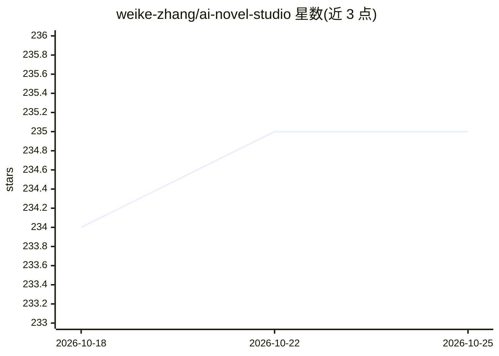

# weike-zhang/ai-novel-studio

⭐ 235 · Go · MIT · 推送 2026-10-03 · [GitHub](https://github.com/weike-zhang/ai-novel-studio) · 个人维护 · 中文 README

**AI 互动小说创作台：世界构建、分支选择与角色状态持久化**

基于 Next.js 与 Go 的 AI 互动小说应用：玩家创建世界并沿私人旅程推进剧情，由模型生成散文；核心机制是生成内容与已提交事实之间的边界——模型可提议动作，但状态补丁不能改名既有角色，服务端在校验后才事务性提交，世界采用冻结快照。后端经 RabbitMQ 队列化生成任务，模型走 OpenAI 兼容请求并可配置端点与回退。含无需 API key 的确定性 Go demo；公开版仅含合成开发数据，不含线上目录与支付集成。面向叙事游戏与有状态 AI 应用的开发者及互动小说玩家。

## 筛选速览

| 维度 | 判定 | 备注 |
|---|---|---|
| AI 角色 | `ai-native` | 本体是模型或模型工具 |
| 许可风险 | `permissive` | MIT |
| 部署形态 | `None` |  |
| 模型依赖 | — | README 未给出锁定关系 |
| 硬件要求 | — | 无带数字的原话,不猜 |
| 安装摩擦 | `low` | 无编译、无系统依赖或容器化 |
| 成熟度 | — | 结构信号不足 |

## 能力要点

- 模型提议—服务端校验—事务提交的回合制故事引擎，拒绝非法状态变更
- 世界冻结快照与已提交上下文的角色/场景校验
- RabbitMQ 队列化生成任务，OpenAI 兼容端点可配置并带回退
- 附带确定性 fake provider 的 Go demo，无需 API key/数据库/Docker

## 适用场景

- 创作带世界设定的 AI 互动小说并做分支选择
- 参考生成散文与存储事实边界的实现，构建叙事游戏或有状态 AI 应用
- 用内存仓库 demo 验证回合提交与非法变更拒绝行为

## 场景标签

`AI 写作` · 领域:内容生成

## 证据(README 行号)

> L3: An AI novel generation platform with world building, interactive choices, and persistent character state.
> L7: AI Novel Studio is an AI interactive fiction application built with Next.js and Go. Create a world, start a private 
> L9: For developers building narrative games or stateful AI applications, the useful part is the boundary between generat

## 星数曲线

2026-10-18 234 → 2026-10-25 235（+1）

---
*卡片 v1 · prompt 1.4 · 生成 2026-10-22 · 置信度 high · 依据 README sha `f9592d5f9c72` · [字段定义](../../DATASET.md)*
