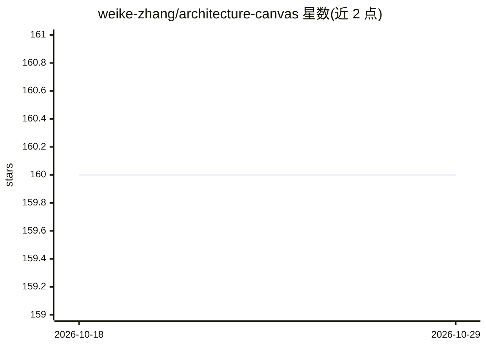

# weike-zhang/architecture-canvas

⭐ 160 · Python · Apache-2.0 · 推送 2026-10-03 · [GitHub](https://github.com/weike-zhang/architecture-canvas) · 个人维护 · 中文 README

**AI 对话生成与修改可编辑架构图的本机工具**

本地运行的架构图助手：上传文档、表格、PDF 或图片，通过多轮对话生成和调整 Excalidraw 画布上的架构图，修改方案先确认再应用，可保留手动位置与样式。模型调用经 DeepSeek Harness 执行，接口兼容 Chat Completions，不绑定特定模型。支持离线手动编辑与导出，对话生成需自配模型服务；联网搜索需自填 Tavily 密钥。需 Python 3.10+ 与 Node.js 22.12+，克隆仓库以脚本启动。当前为 Alpha 版本，仅监听本机，不含多用户与生产部署。

## 筛选速览

| 维度 | 判定 | 备注 |
|---|---|---|
| AI 角色 | `ai-native` | 本体是模型或模型工具 |
| 许可风险 | `permissive` | Apache-2.0 |
| 部署形态 | `None` |  |
| 模型依赖 | — | README 未给出锁定关系 |
| 硬件要求 | — | 无带数字的原话,不猜 |
| 安装摩擦 | `low` | 无编译、无系统依赖或容器化 |
| 成熟度 | `idea` | |

## 能力要点

- 多轮对话生成与修改架构图，变更先列出待确认
- 支持上传 TXT/DOCX/XLSX/PPTX/PDF/图片等并本机解析
- MCP stdio 接入与无状态 Python SDK（render/read_document）
- Tavily 搜索模块可运行中启停、独立打包

## 适用场景

- 把需求文档、PDF 或表格转成可编辑的架构图初稿
- 围绕同一张图持续对话调整架构，同时保留手动排版
- 离线手动整理画布并导出 SVG/PNG

## 场景标签

`AI 助手` `文档解析` · 领域:对话与助手

## 证据(README 行号)

> L3: 通过 AI 对话生成和修改可编辑架构图。上传需求文档、表格、PDF 或图片，让助手阅读资料，再围绕同一张图持续讨论和调整。
> L11: 自有对话工作区与 Excalidraw 画布，使用 DeepSeek Harness 执行模型调用、工具循环和长会话压缩。模型通过兼容 Chat Completions 的接口配置，不绑定 DeepSeek 模型。

## 星数曲线

2026-10-18 160 → 2026-10-29 160（+0）

---
*卡片 v1 · prompt 1.4 · 生成 2026-10-22 · 置信度 high · 依据 README sha `2f253f3fdbe8` · [字段定义](../../DATASET.md)*
