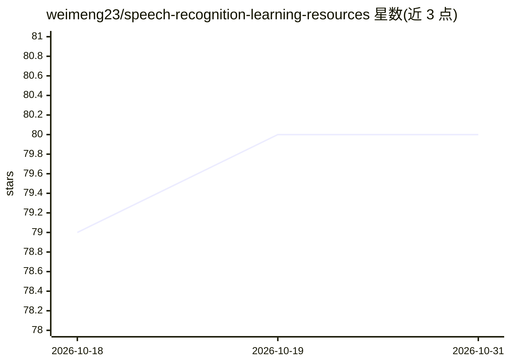

# weimeng23/speech-recognition-learning-resources

⭐ 80 · CC-BY-SA-4.0 · 推送 2026-04-01 · [GitHub](https://github.com/weimeng23/speech-recognition-learning-resources) · [官网](https://github.com/weimeng23/speech-recognition-learning-resources) · 个人维护 · 中文 README

**语音识别学习资源清单：课程、书籍、论文、模型与工具包**

持续更新的语音识别（ASR）学习资源策展清单（Awesome 系列），按课程、书籍、预训练/基础模型、端到端模型、传统模型、教程与工具包分类组织。课程覆盖爱丁堡、斯坦福、台大等高校公开课；书籍含中英文教材并附 PDF；模型条目从 GMM-HMM 到 Whisper、FireRedASR、Qwen3-ASR，附论文与代码链接；工具包收录 Kaldi、next-gen Kaldi（k2/icefall/sherpa 系列）、FunASR、ESPNet、WeNet 等。面向语音识别方向的学习者与研究者。

## 筛选速览

| 维度 | 判定 | 备注 |
|---|---|---|
| AI 角色 | `ai-knowledge` | 知识聚合/清单类 |
| 许可风险 | `viral` | CC-BY-SA-4.0 |
| 部署形态 | `None` |  |
| 模型依赖 | — | README 未给出锁定关系 |
| 硬件要求 | — | 无带数字的原话,不猜 |
| 安装摩擦 | `low` | 无编译、无系统依赖或容器化 |
| 成熟度 | — | 结构信号不足 |

## 能力要点

- 按课程/书籍/模型/教程/工具包分类组织，持续更新
- 模型条目覆盖传统 GMM-HMM 到 2025 年 Qwen3-ASR、FireRedASR，附论文与代码链接
- 工具包部分收录 Kaldi、next-gen Kaldi、FunASR、ESPNet、WeNet 等
- 含多本中文语音识别书籍与中文课程资源

## 适用场景

- 系统入门语音识别，按课程和书籍路径学习
- 查找 ASR 领域代表性论文与对应开源实现
- 比较选型 Kaldi/FunASR/WeNet 等语音识别工具包

## 场景标签

`精选清单` · 领域:学习与行业

## 证据(README 行号)

> L5: A curated list of speech recognition learning resources, models, and toolkits. (continuously updating)
> L9: ## Courses
> L117: ## Toolkits

## 星数曲线

2026-10-18 79 → 2026-10-31 80（+1）

---
*卡片 v1 · prompt 1.4 · 生成 2026-10-24 · 置信度 high · 依据 README sha `a0b2521ecf78` · [字段定义](../../DATASET.md)*
