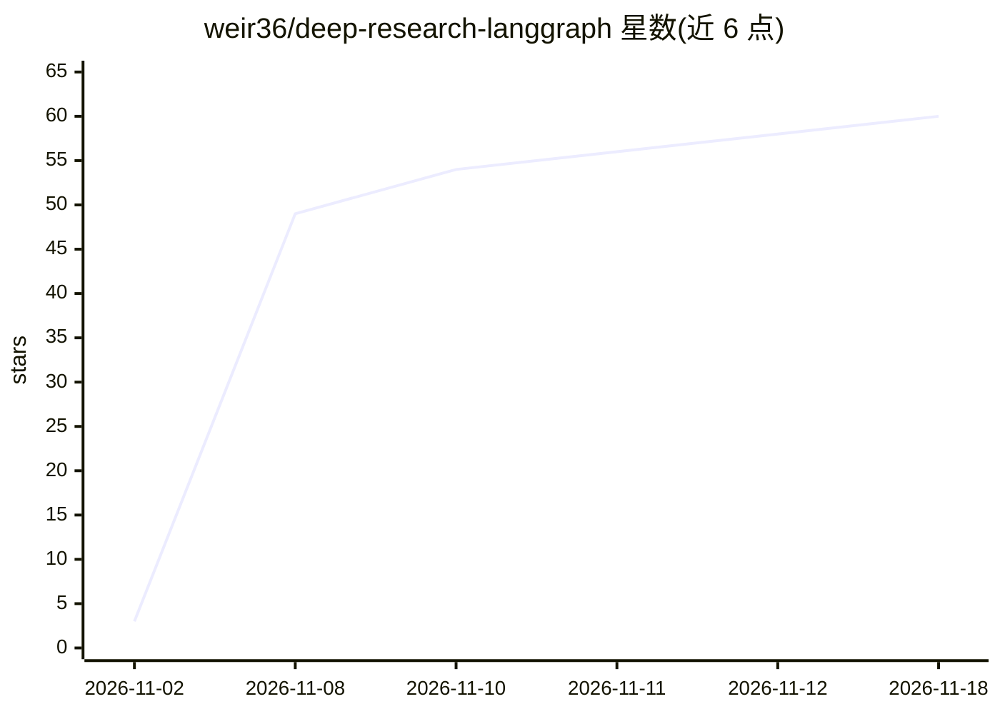

# weir36/deep-research-langgraph

⭐ 60 · Python · MIT · 推送 2026-11-02 · [GitHub](https://github.com/weir36/deep-research-langgraph) · 个人维护 · 中文 README

**LangGraph 多 Agent 深度研究助手：可中断恢复、并行执行、引用治理**

在 deer-flow 基础上重新实现的多 Agent 研究框架：coordinator 识别意图，planner 生成带依赖声明的结构化计划，researcher 并行搜索收集引用，coder 在隔离子进程执行 Python，reporter 合并生成带全局重编号引用的报告。状态不可变 + reducer 合并，checkpoint 经 SQLite 持久化，进程被 SIGKILL 后可恢复且不重做搜索。引用由代码生成（LLM 只写 [[n]] 不写 URL），配五维度评测、消融实验与分层引用诊断，附 5 题评测结果与样本量限制说明。需自备 OpenAI 与 Tavily API key（后者可省略走 mock 搜索）。

## 筛选速览

| 维度 | 判定 | 备注 |
|---|---|---|
| AI 角色 | `ai-native` | 本体是模型或模型工具 |
| 许可风险 | `permissive` | MIT |
| 部署形态 | `library` | 以包/库形式分发 |
| 模型依赖 | — | README 未给出锁定关系 |
| 硬件要求 | — | 无带数字的原话,不猜 |
| 安装摩擦 | `low` | 无编译、无系统依赖或容器化 |
| 成熟度 | — | 结构信号不足 |

## 能力要点

- 依赖感知的步骤并行：独立 research 步骤同时执行，成环退化为顺序
- checkpoint SQLite 持久化，真杀进程后按 thread_id 恢复且不重做已完成的搜索
- 引用治理：局部编号→全局去重重编号，参考文献由代码生成
- Coder 沙箱：独立子进程、超时强杀、资源限制、默认禁用网络

## 适用场景

- 把复杂研究问题拆解为计划并生成带引用的研究报告
- 需要中断后恢复、不重做已完成工作的长时研究任务
- 对 LLM 产出报告的引用准确率做评测与消融归因

## 场景标签

`Agent 框架` `多智能体` `科研工具` · 领域:Agent 开发

## 证据(README 行号)

> L3: 把用户的复杂研究问题拆解为可执行的研究计划，由多个 Agent 协作（规划 → 调研 → 计算 → 写作）生成带引用的研究报告。
> L18: |planner|生成结构化计划（`Plan`），判断信息是否充足，声明步骤依赖|reasoning|

## 星数曲线

2026-11-02 3 → 2026-11-18 60（+57）

---
*卡片 v1 · prompt 1.4 · 生成 2026-11-18 · 置信度 mid · 依据 README sha `20266eb5a732` · [字段定义](../../DATASET.md)*
