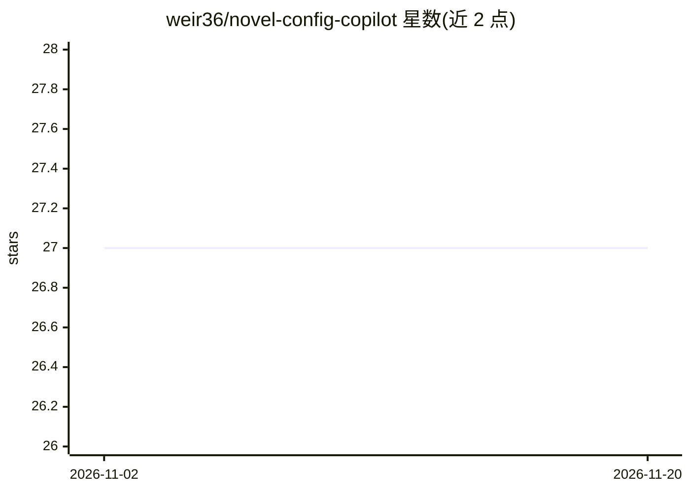

# weir36/novel-config-copilot

⭐ 27 · Python · MIT · 推送 2026-11-03 · [GitHub](https://github.com/weir36/novel-config-copilot) · 个人维护 · 中文 README

**面向网文编辑的资源配置决策系统：GraphRAG+Agent+规则引擎**

个人项目，把政策文档结构化为知识图谱，回答配置咨询并生成资源配置方案。在线链路为意图识别→追问识别→两阶段 GraphRAG 检索→ReAct Agent（7 个工具）→确定性规则引擎兜底校验（R001~R004，违规退回最多 2 轮）。LLM 需自配 OpenAI-compatible 网关（DeepSeek/豆包/通义/自建 vLLM）。所有外部依赖均有本地降级实现（FAISS→numpy、Neo4j→networkx 等）。README 自陈局限：语料仅 6 篇文档、16 个配置项，评测样本小，数据全部为模拟数据。

## 筛选速览

| 维度 | 判定 | 备注 |
|---|---|---|
| AI 角色 | `ai-native` | 本体是模型或模型工具 |
| 许可风险 | `permissive` | MIT |
| 部署形态 | `None` |  |
| 模型依赖 | — | README 未给出锁定关系 |
| 硬件要求 | — | 无带数字的原话,不猜 |
| 安装摩擦 | `medium` | 含编译或系统依赖之一 |
| 成熟度 | — | 结构信号不足 |

## 能力要点

- 意图→追问→GraphRAG→ReAct Agent→规则引擎的五段在线链路
- 规则引擎兜底：方案合并当前配置后校验依赖/互斥/取值，违规标「请勿直接使用」
- 外部依赖 auto 模式：探测不到生产组件时降级本地实现并在 /api/health 标注
- 实体抽取支持词表与 LLM 两种，LLM 路径带四层消歧

## 适用场景

- 编辑查询某配置项如何开启或为何未获全勤
- 为作品生成整资源配置方案并自动校验合规
- 复现 GraphRAG 与纯大模型的对照评测

## 场景标签

`知识图谱` `RAG` · 领域:知识与检索

## 证据(README 行号)

> L4: > 用 GraphRAG 做检索、ReAct Agent 做多步推理、确定性规则引擎做兜底校验，
> L91: 4. **生成**：解释类单次生成；推荐 / 优化类走 ReAct Agent，7 个工具把必须精确的事交给代码

## 星数曲线

2026-11-02 27 → 2026-11-20 27（+0）

---
*卡片 v1 · prompt 1.4 · 生成 2026-11-18 · 置信度 high · 依据 README sha `152a36c70889` · [字段定义](../../DATASET.md)*
