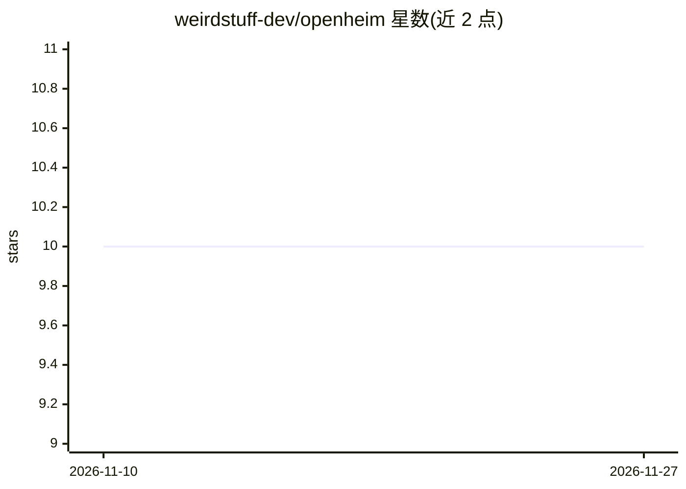

# weirdstuff-dev/openheim

⭐ 10 · Rust · MIT · 推送 2026-11-17 · [GitHub](https://github.com/weirdstuff-dev/openheim) · [官网](https://openheim.io) · 个人维护

**多 provider 的开源 Rust AI agent 运行时，随处运行**

以 Rust 编写的 agent 运行时，执行迭代式 agent 循环：调用 LLM、代其执行工具、回填结果并重复直至任务完成。可运行为交互式 TUI、headless CLI、面向 Zed/Claude Code 等 ACP 客户端的 stdio agent，或自托管的 ACP-over-WebSocket 服务器，并可作为 Rust 库嵌入应用。内置 shell、文件读写、搜索、长期记忆等工具，支持 MCP 服务器接入与子 agent 委派；shell 执行默认关闭，文件访问受工作目录沙箱限制。

## 筛选速览

| 维度 | 判定 | 备注 |
|---|---|---|
| AI 角色 | `ai-ecosystem` | LLM/agent 周边工具 |
| 许可风险 | `permissive` | MIT |
| 部署形态 | `self-host` | docker 或自建部署 |
| 模型依赖 | local-ok | 支持本地模型 |
| 硬件要求 | — | 无带数字的原话,不猜 |
| 安装摩擦 | `low` | 无编译、无系统依赖或容器化 |
| 成熟度 | — | 结构信号不足 |

## 能力要点

- 多 provider：OpenAI、Anthropic Claude、Google Gemini 及任意 OpenAI 兼容端点（Ollama、vLLM、LM Studio）
- 四种运行形态：TUI、headless CLI、ACP stdio agent、ACP-over-WebSocket 服务器
- 内置工具集与 trait 扩展机制，支持 MCP 外部服务器与子 agent 委派
- SQLite FTS5 关键词记忆开箱即用，可加嵌入 provider 升级为 sqlite-vec 语义搜索

## 适用场景

- 在终端以 TUI 交互式运行 agent 完成编码/文件任务
- 为 Zed 等编辑器提供 ACP agent 后端
- 自托管 WebSocket 服务器供远程客户端调用 agent 会话
- 将 agent 运行时以 crate 形式嵌入自己的 Rust 应用

## 场景标签

`Agent 框架` · 领域:Agent 开发

## 证据(README 行号)

> L13: One open-source runtime for your terminal, your editor, a server or your own Rust app. Bring any model.
> L21: Openheim runs an iterative agent loop — it calls your LLM, executes tools on its behalf, feeds results back, and re
> L34: - **Multi-provider** — OpenAI, Anthropic Claude, Google Gemini, and any OpenAI-compatible endpoint (Ollama, vLLM, L

## 星数曲线

2026-11-10 10 → 2026-11-27 10（+0）

---
*卡片 v1 · prompt 1.4 · 生成 2026-11-19 · 置信度 high · 依据 README sha `357076f8d3d7` · [字段定义](../../DATASET.md)*
