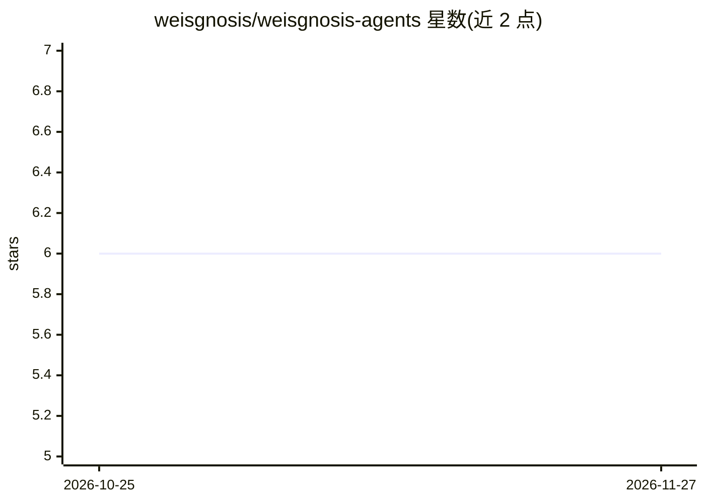

# weisgnosis/weisgnosis-agents

⭐ 6 · Scala · Apache-2.0 · 推送 2026-10-18 · [GitHub](https://github.com/weisgnosis/weisgnosis-agents) · [官网](https://www.weisgnosis.com/) · 个人维护

**面向 Scala/ZIO 开发者的类型化工具 agent 运行时库**

Scala 3 / ZIO 2 编写的 agent 运行时库：应用方提供模型与工具，库负责模型调用工具时的参数校验、授权、执行与结果记录，并提供中断恢复、审批检查点与多 agent 协作（顺序管线、有界并发、MsgHub、监督子代理）。工具 schema 在编译期生成并做运行时校验。分五个模块发布于 Maven Central（core/harness/mcp/storage-postgresql/otel）。不支持内置的 shell/文件/网络工具包与 RAG 引擎，检查点不跨进程恢复。

## 筛选速览

| 维度 | 判定 | 备注 |
|---|---|---|
| AI 角色 | `ai-ecosystem` | LLM/agent 周边工具 |
| 许可风险 | `permissive` | Apache-2.0 |
| 部署形态 | `None` |  |
| 模型依赖 | — | README 未给出锁定关系 |
| 硬件要求 | — | 无带数字的原话,不猜 |
| 安装摩擦 | `medium` | 含编译或系统依赖之一 |
| 成熟度 | `idea` | |

## 能力要点

- 编译期生成工具参数 schema，运行时校验模型调用
- 中断恢复：保留已完成结果、等待资源释放、为未完成调用记录错误
- 多 agent 协作原语：管线、有界 fanout、MsgHub、监督子代理
- 五模块按需引入，含 MCP 接入、PostgreSQL 持久化与 OpenTelemetry 追踪

## 适用场景

- 在既有 Scala 服务中嵌入调用业务函数的助手
- 为受限工具添加审批检查点与授权控制
- 用多个专职 agent（分析/审核/汇报）构建工作流
- 接入 MCP 服务器提供的工具与资源

## 场景标签

`Agent 框架` `多智能体` · 领域:Agent 开发

## 证据(README 行号)

> L5: WeisGnosis Agents is a Scala 3 / ZIO 2 library for agents that call your service's functions and work together. Your
> L122: When a model calls a business function, the application needs to validate its arguments, authorize the action, exe

## 星数曲线

2026-10-25 6 → 2026-11-27 6（+0）

---
*卡片 v1 · prompt 1.4 · 生成 2026-11-20 · 置信度 high · 依据 README sha `3c792826dd39` · [字段定义](../../DATASET.md)*
