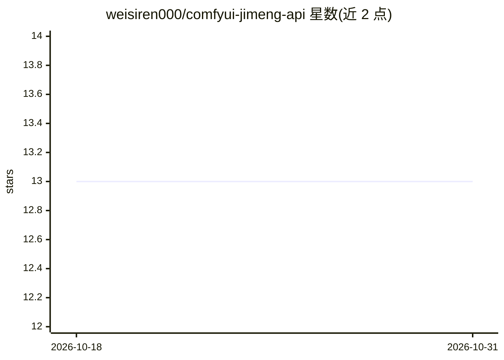

# weisiren000/comfyui-jimeng-api

⭐ 13 · Python · NOASSERTION · 推送 2025-12-08 · [GitHub](https://github.com/weisiren000/comfyui-jimeng-api) · 个人维护 · 中文 README

**ComfyUI 插件：调用火山引擎即梦 API 生图并通过 OSC 通知外部程序**

ComfyUI 自定义节点插件，封装火山引擎即梦（Seedream 4.0，doubao-seedream-4-0-250828）图像生成 API：支持文生图、最多 10 张参考图的多图融合、最多 15 张组图输出、4K 分辨率与流式返回，需自备火山方舟 API Key，按张数与 token 计费。另含增强版文件保存节点，提供前缀/自定义命名、覆盖控制、按日期分目录，保存完成后可通过 OSC 协议向 TouchDesigner、Max/MSP、Ableton Live 等发送通知消息。v2.0.0 起支持 ComfyUI V3 Extension Definition API 并保留 V1 兼容模式，插件自动检测版本。安装方式为复制到 custom_nodes 目录并 pip 安装依赖。

## 筛选速览

| 维度 | 判定 | 备注 |
|---|---|---|
| AI 角色 | `ai-native` | 本体是模型或模型工具 |
| 许可风险 | `none` | NOASSERTION |
| 部署形态 | `library` | 以包/库形式分发 |
| 模型依赖 | — | README 未给出锁定关系 |
| 硬件要求 | — | 无带数字的原话,不猜 |
| 安装摩擦 | `low` | 无编译、无系统依赖或容器化 |
| 成熟度 | — | 结构信号不足 |

## 能力要点

- 即梦 Seedream 4.0 文生图/多图融合/组图（最多15张）/4K/流式输出
- 增强版文件保存节点：命名模式、覆盖控制、时间戳与日期子目录
- 保存完成后通过 OSC 向 TouchDesigner/Max/MSP 等发送通知
- 同时支持 ComfyUI V3 Extension API 与 V1 兼容模式，自动检测版本

## 适用场景

- 在 ComfyUI 工作流中直接调用即梦 API 生成图片
- 批量生成图片并按前缀/日期规则命名保存
- 生图完成后触发 TouchDesigner 等可视化程序的联动处理

## 场景标签

`图像生成` · 领域:内容生成

## 证据(README 行号)

> L3: 这是一个 ComfyUI 自定义节点插件，用于集成火山引擎即梦图像生成 API 和智能文件保存功能。
> L52: 在 ComfyUI 中添加 "即梦图像生成" 节点，配置以下参数：

## 星数曲线

2026-10-18 13 → 2026-10-31 13（+0）

---
*卡片 v1 · prompt 1.4 · 生成 2026-10-31 · 置信度 mid · 依据 README sha `8f7380c0e9f4` · [字段定义](../../DATASET.md)*
