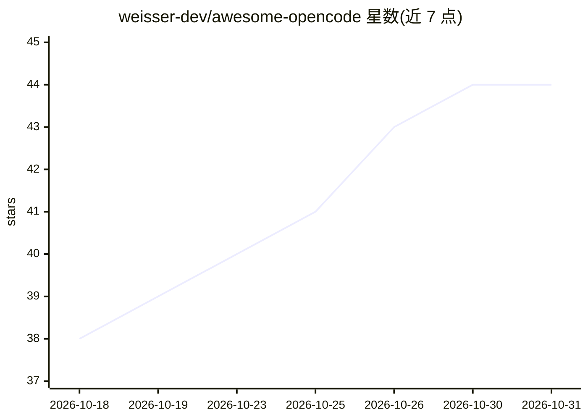

# weisser-dev/awesome-opencode

⭐ 44 · JavaScript · MIT · 推送 2026-10-23 · [GitHub](https://github.com/weisser-dev/awesome-opencode) · [官网](https://www.npmjs.com/package/@weisser-dev/awesome-opencode) · 个人维护

**面向 OpenCode 的 agent/技能策展集与交互式配置 CLI**

为开源 AI 编码代理 OpenCode 收录 108 个 agent（按 10 类组织，覆盖核心开发、语言专家、基础设施、质量安全、数据 AI 等）、15 个技能、3 个技能包（design/process/behavior）与 18 个策展 MCP 服务器。提供 npx 一条命令的交互式 CLI：分析项目、引导选择 agent/技能/模型/MCP 配置、生成文件并启动 OpenCode，重跑时记忆上次设置。技能包来自第三方仓库，固定到上游 commit 并做 sha256 校验，不执行任何上游脚本。

## 筛选速览

| 维度 | 判定 | 备注 |
|---|---|---|
| AI 角色 | `ai-knowledge` | 知识聚合/清单类 |
| 许可风险 | `permissive` | MIT |
| 部署形态 | `self-host` | docker 或自建部署 |
| 模型依赖 | — | README 未给出锁定关系 |
| 硬件要求 | — | 无带数字的原话,不猜 |
| 安装摩擦 | `low` | 无编译、无系统依赖或容器化 |
| 成熟度 | — | 结构信号不足 |

## 能力要点

- 108 个 agent 按 10 类组织，15 个技能与 3 个技能包
- npx 交互式 CLI 分析项目并生成 agent/技能/模型/MCP 配置
- 18 个策展 MCP 服务器与实时 MCP 注册表搜索
- 技能包固定上游 commit，sha256 校验，不执行上游脚本

## 适用场景

- 为 OpenCode 一键配置全套专业 agent 与技能
- 浏览并挑选适合自己技术栈的编码 agent
- 安装经审阅的 design/process/behavior 技能包

## 场景标签

`精选清单` · 领域:学习与行业

## 证据(README 行号)

> L3: The most comprehensive collection of agents, skills, and tooling for OpenCode -- the open-source AI coding agent.
> L5: **108 agents** | **15 skills** | **3 skill packs** | **18 curated MCP servers** | **Live MCP registry search** | **S
> L15: One command. It analyzes your project, walks you through agent/skill/model/MCP setup interactively, generates every

## 星数曲线

2026-10-18 38 → 2026-10-31 44（+6）

---
*卡片 v1 · prompt 1.4 · 生成 2026-10-25 · 置信度 mid · 依据 README sha `377aa3587201` · [字段定义](../../DATASET.md)*
