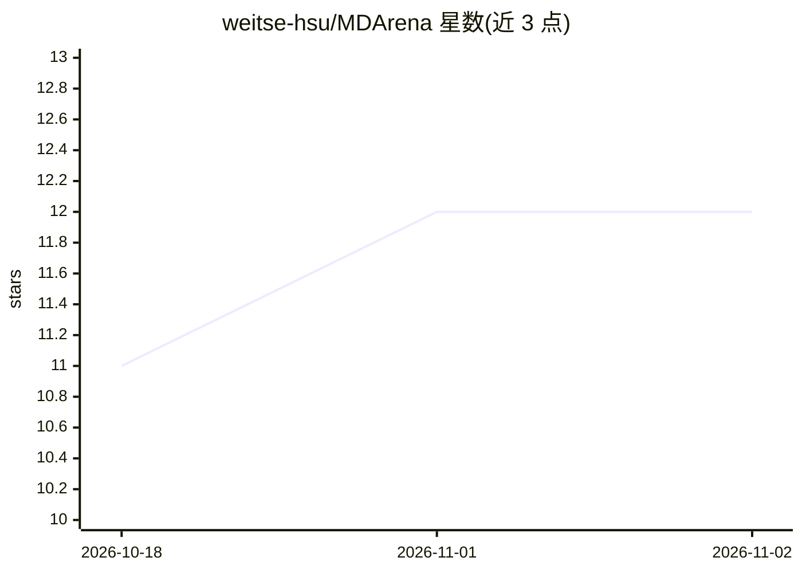

# weitse-hsu/MDArena

⭐ 12 · Python · NOASSERTION · 推送 2026-08-29 · [GitHub](https://github.com/weitse-hsu/MDArena) · [官网](https://github.com/weitse-hsu/MDArena) · 组织维护

**评估 AI agent 在分子动力学工作流上表现的基准（50 任务）**

面向编码 agent 的开放评测基准：50 个任务取自真实计算化学研究项目，每个任务含输入文件（蛋白质结构/轨迹等）、书面指令和自动验证器，任务在 Docker 容器中运行，由 Harbor CLI 启动容器、下发指令并评分（通过/失败或部分得分）。任务覆盖经典 MD、伞形采样、自由能计算等，涉及 GROMACS、AMBER、OpenMM 等工具。默认验证器使用 Claude 模型，需 Anthropic 凭证；附论文（arXiv:2608.02642）。主要贡献者来自牛津大学。

## 筛选速览

| 维度 | 判定 | 备注 |
|---|---|---|
| AI 角色 | `ai-ecosystem` | LLM/agent 周边工具 |
| 许可风险 | `permissive` | NOASSERTION |
| 部署形态 | `self-host` | docker 或自建部署 |
| 模型依赖 | — | README 未给出锁定关系 |
| 硬件要求 | — | 无带数字的原话,不猜 |
| 安装摩擦 | `low` | 无编译、无系统依赖或容器化 |
| 成熟度 | — | 结构信号不足 |

## 能力要点

- 50 个多步骤任务取自真实计算化学研究项目
- 每个任务附自动验证器，输出 pass/fail 或部分得分
- 由 Harbor CLI 在 Docker 容器中驱动，支持批量运行
- 提供轨迹扫描脚本与提交校验脚本用于结果核验

## 适用场景

- 评测编码 agent 在分子动力学多步工作流上的能力
- 科研团队发布可核验的 agent 评测结果
- 为计算化学研究贡献新评测任务

## 场景标签

`模型评测` · 领域:评测与运维

## 证据(README 行号)

> L10: **MDArena** is an open benchmark for evaluating AI agents on molecular dynamics
> L21: Each task bundles the following: input files (e.g. a protein structure or trajectory), written instructions describ

## 星数曲线

2026-10-18 11 → 2026-11-02 12（+1）

---
*卡片 v1 · prompt 1.4 · 生成 2026-10-31 · 置信度 mid · 依据 README sha `6a329c8ae7e4` · [字段定义](../../DATASET.md)*
