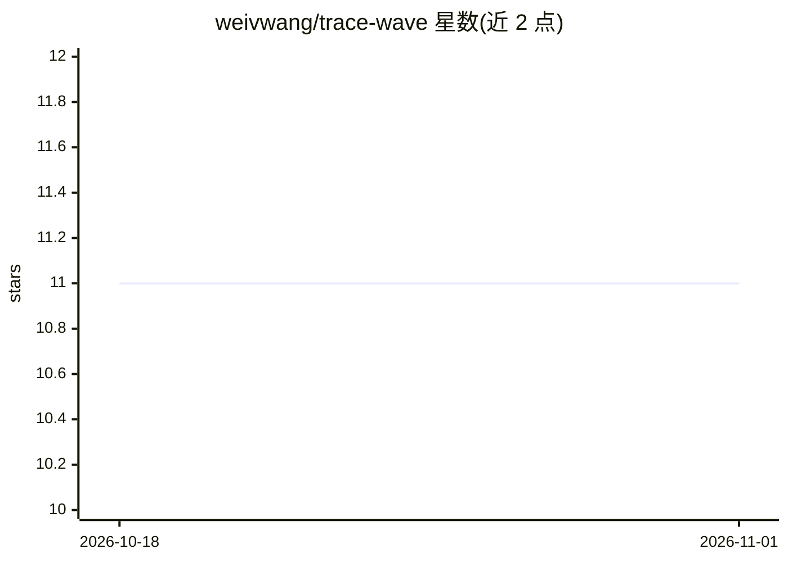

# weivwang/trace-wave

⭐ 11 · Python · MIT · 推送 2026-08-22 · [GitHub](https://github.com/weivwang/trace-wave) · 个人维护 · 中文 README

**面向 AI Agent 的分布式追踪与可观测性工具（自称 Datadog for AI Agents）**

traceweave 是开源的多 Agent 系统追踪与可观测性平台：通过 instrument_all() 零配置自动插桩 OpenAI/Anthropic/LangChain 调用，或用 @trace_agent/@trace_tool/@trace_llm 装饰器逐函数追踪；按 span 记录 AGENT/TOOL/LLM 等类型，附 token 计数与成本估算，错误捕获含完整堆栈。提供 Rich 终端 TUI 与自托管 Web 面板（localhost:8420），可导出 JSON 与 Chrome DevTools 格式。纯 Python 约 3K 行，pip 安装，面向 Agent 开发者与 LLM 应用团队。

## 筛选速览

| 维度 | 判定 | 备注 |
|---|---|---|
| AI 角色 | `ai-ecosystem` | LLM/agent 周边工具 |
| 许可风险 | `permissive` | MIT |
| 部署形态 | `library` | 以包/库形式分发 |
| 模型依赖 | — | README 未给出锁定关系 |
| 硬件要求 | — | 无带数字的原话,不猜 |
| 安装摩擦 | `low` | 无编译、无系统依赖或容器化 |
| 成熟度 | — | 结构信号不足 |

## 能力要点

- instrument_all() 零配置自动插桩 OpenAI/Anthropic/LangChain
- @trace_agent/@trace_tool/@trace_llm 装饰器 API，支持同步与异步
- 逐 span 的 token 计数与成本估算，错误捕获含堆栈
- Rich 终端 TUI + 自托管 Web 面板 + Chrome DevTools 导出

## 适用场景

- 调试多 Agent 流水线，定位失败的 agent 或工具
- 生产环境监控 LLM 调用的 token 成本去向
- 接入现有观测体系（导出 JSON/chrome://tracing）

## 场景标签

`LLM 可观测性` · 领域:评测与运维

## 证据(README 行号)

> L17: **traceweave** is the **Datadog for AI Agents** — an open-source distributed tracing and observability platform bui
> L32: 1. 🎯 **Zero-Config Instrumentation** — Auto-trace OpenAI, Anthropic, LangChain with `instrument_all()`. No code cha

## 星数曲线

2026-10-18 11 → 2026-11-01 11（+0）

---
*卡片 v1 · prompt 1.4 · 生成 2026-11-01 · 置信度 high · 依据 README sha `36e1d4472c9a` · [字段定义](../../DATASET.md)*
