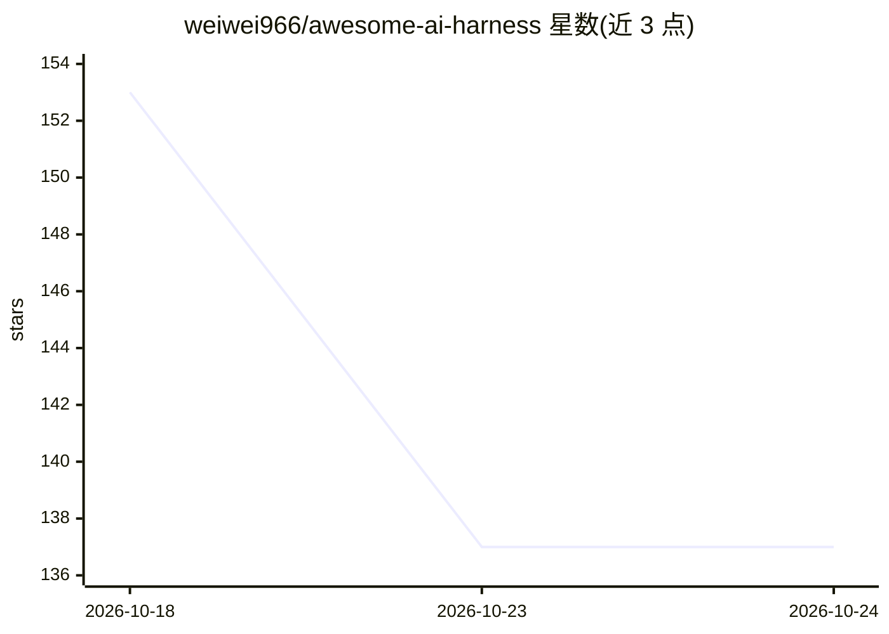

# weiwei966/awesome-ai-harness

⭐ 137 · CC0-1.0 · 推送 2026-08-19 · [GitHub](https://github.com/weiwei966/awesome-ai-harness) · 个人维护 · 中文 README

**AI agent harness 工程知识清单：上下文/工具/循环/记忆等主题策展**

一个关于 harness engineering（将语言模型变为可用 agent 的运行时脚手架工程）的策展资源清单，覆盖基础文献、术语、上下文工程、工具设计与 agent-computer 接口、agent 循环、记忆与会话恢复、多 agent 编排、沙箱与运行时隔离等章节，收录工程博客、论文与系统提示相关资料。明确限定范围为推理时 harness，不包含 RL 训练环境类 harness。提供英文与中文版本，面向从事 agent 构建的开发者与学习者。

## 筛选速览

| 维度 | 判定 | 备注 |
|---|---|---|
| AI 角色 | `ai-knowledge` | 知识聚合/清单类 |
| 许可风险 | `viral` | CC0-1.0 |
| 部署形态 | `None` |  |
| 模型依赖 | — | README 未给出锁定关系 |
| 硬件要求 | — | 无带数字的原话,不猜 |
| 安装摩擦 | `low` | 无编译、无系统依赖或容器化 |
| 成熟度 | — | 结构信号不足 |

## 能力要点

- 按上下文工程、工具设计、agent 循环、记忆、多 agent 编排、沙箱隔离等主题组织条目
- 收录 Lilian Weng、Anthropic、OpenAI 等来源的 harness 工程文献与论文
- 明确范围：只覆盖推理时 harness，排除 RL 训练环境类内容
- 提供 EN/中文双语版本

## 适用场景

- 系统学习 agent harness 工程的设计模式与实践资料
- 查找上下文管理、工具 schema 设计、沙箱隔离等具体子领域的参考文献
- 了解 harness 与框架术语边界及该领域知识地图

## 场景标签

 · 领域:AI agent 工程知识/LLM 基础设施

## 证据(README 行号)

> L5: A curated list of resources on **harness engineering** — the discipline of building the runtime scaffolding that tur
> L11: Most "awesome agent" lists catalogue *frameworks*. This one is about the layer underneath: the concrete engineering
> L32: ## Contents

## 星数曲线

2026-10-18 153 → 2026-10-24 137（-16）

---
*卡片 v1 · prompt 1.4 · 生成 2026-10-23 · 置信度 high · 依据 README sha `05d189bd7c9d` · [字段定义](../../DATASET.md)*
