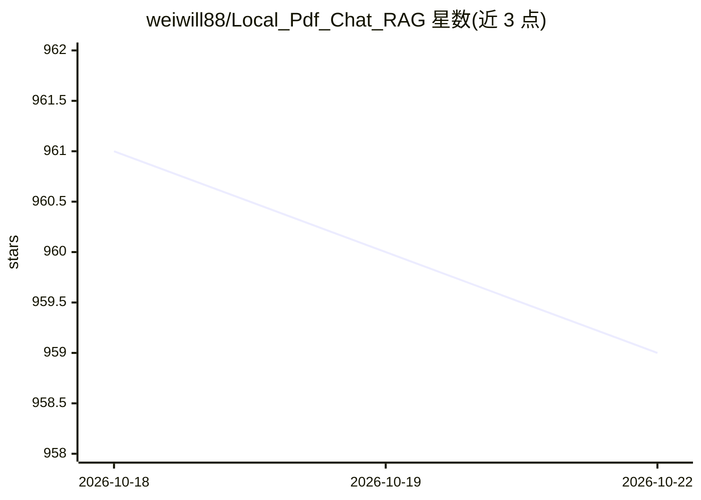

# weiwill88/Local_Pdf_Chat_RAG

⭐ 958 · Python · MIT · 推送 2026-08-31 · [GitHub](https://github.com/weiwill88/Local_Pdf_Chat_RAG) · [官网](https://github.com/weiwill88/Local_Pdf_Chat_RAG#readme) · 个人维护 · 中文 README

**本地 PDF 问答的 RAG 参考实现：混合检索+重排+双接口**

面向希望检视完整 RAG 流水线的开发者提供的教学与参考实现：文档解析、分块、嵌入、FAISS 稠密检索与 BM25 关键词检索的混合召回、可选 CrossEncoder/LLM 重排、答案生成拆分为可读可替换的模块。支持 PDF/TXT/Markdown/DOCX/XLSX/PPTX 等格式，模型后端可选本地 Ollama、SiliconFlow 或 OpenAI 兼容 API，提供 Gradio Web UI 与 FastAPI REST API 两套接口。README 声明非生产就绪：索引驻留进程内存、重启后需重建、PDF 不含通用 OCR。

## 筛选速览

| 维度 | 判定 | 备注 |
|---|---|---|
| AI 角色 | `ai-native` | 本体是模型或模型工具 |
| 许可风险 | `permissive` | MIT |
| 部署形态 | `library` | 以包/库形式分发 |
| 模型依赖 | local-ok | 支持本地模型 |
| 硬件要求 | — | 无带数字的原话,不猜 |
| 安装摩擦 | `low` | 无编译、无系统依赖或容器化 |
| 成熟度 | — | 结构信号不足 |

## 能力要点

- FAISS 稠密检索 + BM25 关键词检索的混合召回
- 可选 CrossEncoder 或 LLM 两种重排方式（RERANK_METHOD）
- 本地 Ollama / SiliconFlow / OpenAI 兼容 API 多后端
- Gradio Web UI 与 FastAPI REST API（status/upload/ask 端点）

## 适用场景

- 学习并逐模块检视 RAG 流水线各环节的实现
- 搭建本地文档问答的实验原型
- 通过 REST API 将 RAG 问答集成到自己的服务中

## 场景标签

 · 领域:LLM 基础设施/RAG

## 证据(README 行号)

> L13: Local PDF Chat RAG is an educational and reference implementation for developers who want to inspect the complete r
> L41: - **Multiple model backends**: local Ollama, SiliconFlow, and OpenAI-compatible APIs.
> L98: - `POST /api/ask`: ask a question against processed documents.

## 星数曲线

2026-10-18 961 → 2026-10-22 959（-2）

---
*卡片 v1 · prompt 1.4 · 生成 2026-10-21 · 置信度 mid · 依据 README sha `44afedbea4c3` · [字段定义](../../DATASET.md)*
