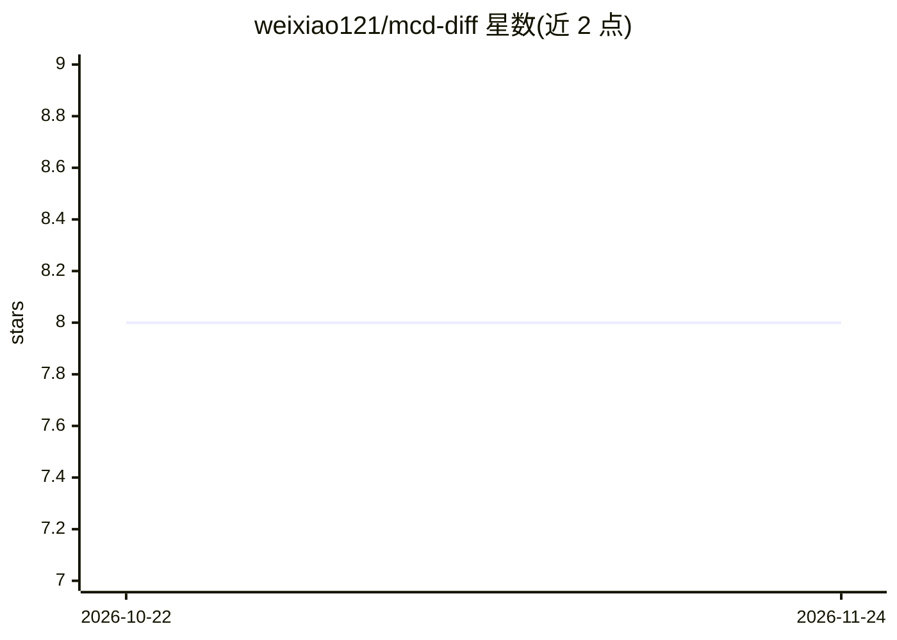

# weixiao121/mcd-diff

⭐ 8 · Python · NOASSERTION · 推送 2026-10-09 · [GitHub](https://github.com/weixiao121/mcd-diff) · [官网](https://weixiao121.github.io/mcd-diff/) · 个人维护 · 中文 README

**给麦当劳老客复盘历史订单：同等预算与热量下算可省差额**

读取用户麦当劳 MCP 的历史订单与在售菜单、营养数据，在「预算上限=该单实付、热量上限=该单实际热量」的约束下用全枚举求解器逐单重算，输出 diff 报告（HTML/Markdown/JSON），含差额账簿、三条目标函数不同的重开路线与平行宇宙对比。采集与计算分离：MCP 客户端用标准库实现，计算层零第三方依赖、确定性可复现；全程只读，拦截交易类工具调用。需要 Python 3.10+ 与麦当劳 MCP Token，也可用虚构示例数据离线运行。

## 筛选速览

| 维度 | 判定 | 备注 |
|---|---|---|
| AI 角色 | `ai-enhanced` | 去掉 AI 部分产品仍成立 |
| 许可风险 | `none` | NOASSERTION |
| 部署形态 | `None` |  |
| 模型依赖 | — | README 未给出锁定关系 |
| 硬件要求 | — | 无带数字的原话,不猜 |
| 安装摩擦 | `low` | 无编译、无系统依赖或容器化 |
| 成熟度 | `idea` | |

## 能力要点

- 同等预算∩同等热量约束下的逐单反事实重算，全枚举得精确最优解
- 自带标准库 MCP 客户端（Streamable HTTP），零第三方依赖
- 三条重开路线（省钱/扎实/轻负担）约束相同、目标函数不同
- 只读边界：assert_readonly() 拦截交易类工具，报告离线生成

## 适用场景

- 复盘一年的麦当劳订单，看同等条件下本可以省多少钱
- 既想省钱又不想改变点单结构，只要等效替换方案
- 不装环境，用示例数据生成报告预览效果

## 场景标签

`数据分析` · 领域:效率与自动化

## 证据(README 行号)

> L197: - **采集与计算分离**：MCP 只负责取数落盘；计算层零网络、零依赖、可单测、可复现。
> L200: - **Agent 是编排者，不是计算器**：LLM 调用工具与叙述；确定性算法负责差额与求解。
> L201: - **只读边界**：全程不调用任何交易类工具，`assert_readonly()` 硬拦截。

## 星数曲线

2026-10-22 8 → 2026-11-24 8（+0）

---
*卡片 v1 · prompt 1.4 · 生成 2026-11-20 · 置信度 high · 依据 README sha `a39c88d628f1` · [字段定义](../../DATASET.md)*
