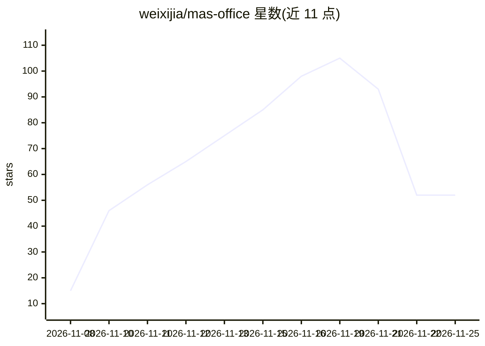

# weixijia/mas-office

⭐ 52 · JavaScript · MIT · 推送 2026-11-11 · [GitHub](https://github.com/weixijia/mas-office) · [官网](https://www.xijiawei.com/mas-office/) · 个人维护 · 中文 README

**多智能体系统可视化运行框架：设计、监督并核查 AI 团队**

框架无关的多智能体编排与观测工具：团队中每个角色是用户本机上真实的 Claude Code 或 Codex 会话，用 structure.json 设计角色、工具权限与检查点后加锁运行；调度由普通代码执行，每个工具调用经过统一决策点。提供等距办公室面板、集中式 'Needs you' 收件箱处理审批与提问，可用消息实时引导（steer/queue/interrupt）各会话。答案核查机制：声明带来源标注、链接由普通代码校验、干净上下文的 checker 对每条声明给出 supported/partial/contradicted 判定。首个用例为研究与决策任务（比价、行程、文献核查）。v0.3.0 状态下评估运行、桌面应用等尚未完成，团队是否优于单 agent 也未测量。

## 筛选速览

| 维度 | 判定 | 备注 |
|---|---|---|
| AI 角色 | `ai-ecosystem` | LLM/agent 周边工具 |
| 许可风险 | `permissive` | MIT |
| 部署形态 | `library` | 以包/库形式分发 |
| 模型依赖 | locked-api |  |
| 硬件要求 | — | 无带数字的原话,不猜 |
| 安装摩擦 | `low` | 无编译、无系统依赖或容器化 |
| 成熟度 | `idea` | |

## 能力要点

- 每个角色是本机真实的 Claude Code / Codex 会话，工具权限在加锁设计时编译执行
- 'Needs you' 收件箱集中处理所有会话的审批、提问、checker 标记与阶段检查点
- 答案核查：claim 级来源标注 + 普通代码校验链接 + 干净上下文 checker 判定
- 框架无关的事件协议（v0.2）配套 JS 与 Python SDK，零依赖

## 适用场景

- 编排一个多角色 AI 团队做比价、行程规划、文献与可行性核查等研究任务
- 实时观看每个 agent 的进展并在需要时介入审批或引导方向
- 对 AI 团队的产出做声明级来源核验与矛盾检测

## 场景标签

`多智能体` `Agent 框架` `科研工具` · 领域:Agent 开发

## 证据(README 行号)

> L17: Every role in the team is a real Claude Code or Codex session on your computer, signed in by you. You design the ro
> L25: > **Status (v0.3.0).** `mas-office up` runs a locked team on real Claude Code and Codex sessions. The office view, 
> L145: - Each role runs the unmodified `claude` or `codex` installed on your computer: Claude Code through Anthropic's Ag

## 星数曲线

2026-11-08 15 → 2026-11-25 52（+37）

---
*卡片 v1 · prompt 1.4 · 生成 2026-11-17 · 置信度 mid · 依据 README sha `43acc4bca254` · [字段定义](../../DATASET.md)*
