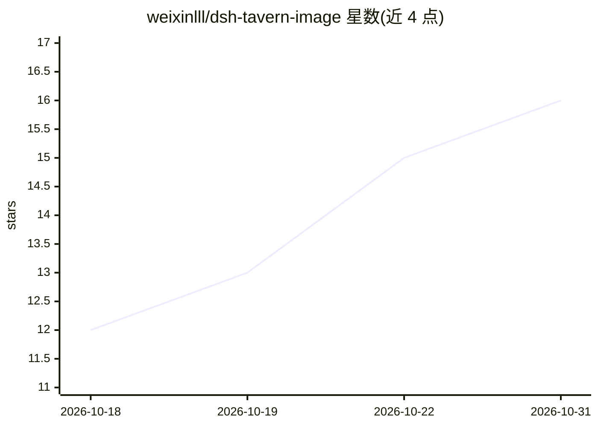

# weixinlll/dsh-tavern-image

⭐ 16 · JavaScript · MIT · 推送 2026-10-21 · [GitHub](https://github.com/weixinlll/dsh-tavern-image) · 个人维护 · 中文 README

**DSH Tavern 的剧情配图插件：读取正文选场景并接生图服务出图**

面向 DSH Tavern（角色扮演/故事宿主）的剧情配图插件：读取已完成正文，由规划模型挑选适合画成插图的场景、决定插入位置并生成提示词，再交给本地 ComfyUI / SD WebUI / Forge 或 NovelAI、OpenAI Images、Gemini、Grok、火山方舟 Seedream、百炼 Qwen-Image 等在线渠道出图，按剧情位置插回消息。人物库集中维护角色外貌与服装，支持角色随剧情变化的历史记录、画风与提示词预设、ComfyUI 简单模式与 API 工作流导入及可视化编辑。注意：v3.0.0 为最后独立版本，功能已内嵌到 DSH Tavern 3.0 本体，本仓库仅保留源码与历史版本。

## 筛选速览

| 维度 | 判定 | 备注 |
|---|---|---|
| AI 角色 | `ai-native` | 本体是模型或模型工具 |
| 许可风险 | `permissive` | MIT |
| 部署形态 | `desktop` | 安装包/桌面程序 |
| 模型依赖 | locked-api |  |
| 硬件要求 | — | 无带数字的原话,不猜 |
| 安装摩擦 | `low` | 无编译、无系统依赖或容器化 |
| 成熟度 | — | 结构信号不足 |

## 能力要点

- 规划模型自动选场景、定位置、写提示词，图片与正文版本绑定
- 支持本地 ComfyUI / SD WebUI / Forge 及多种在线生图渠道，可配多条渠道切换
- 人物库维护外貌与服装，角色历史按剧情线记录永久外貌变化
- ComfyUI 简单模式直接选模型参数，工作流模式导入 API 格式 JSON 并可视化编辑

## 适用场景

- 给长篇角色扮演或故事的正文自动配插图
- 长篇连载中维护角色外貌与服装资料，减少提示词前后不一致
- 重写或切换回复版本时保留对应版本的配图
- 用自己的 ComfyUI 工作流和本地模型出图

## 场景标签

`图像生成` · 领域:内容生成

## 证据(README 行号)

> L22: 给 DSH Tavern 用的剧情配图插件。它读取已经完成的正文，挑选适合画成插图的场景，再交给你配置的生图服务生成，按剧情位置插回消息里。
> L24: 可以用本地 ComfyUI、SD WebUI / Forge，也可以接 NovelAI、OpenAI Images、Gemini 等在线服务。人物资料、画风、提示词规则和图片记录在同一个面板里管理，适合给长篇角色扮演和故事配图。
> L192: |提供商|接入方式|
> L200: |Seedream / 火山方舟|Ark 图片接口|

## 星数曲线

2026-10-18 12 → 2026-10-31 16（+4）

---
*卡片 v1 · prompt 1.4 · 生成 2026-10-30 · 置信度 mid · 依据 README sha `2cac52d48701` · [字段定义](../../DATASET.md)*
