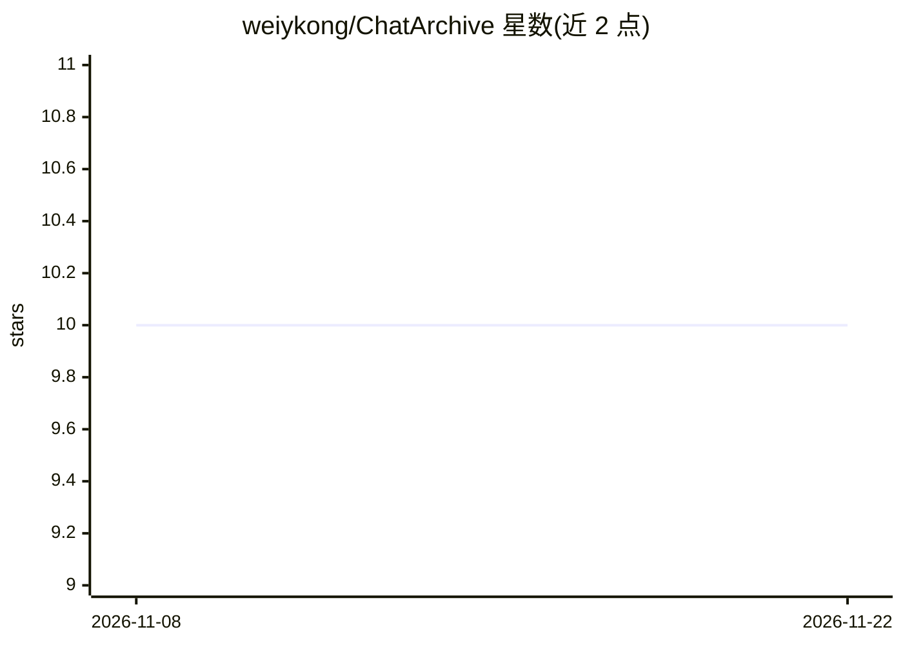

# weiykong/ChatArchive

⭐ 10 · JavaScript · MIT · 推送 2026-11-11 · [GitHub](https://github.com/weiykong/ChatArchive) · [官网](https://weiykong.github.io/ChatArchive/) · 个人维护

**浏览器扩展：把 13 家 AI 聊天记录导出为本地文件**

Chromium 扩展，从 ChatGPT、Gemini、Claude、DeepSeek、Perplexity 等 13 个 AI 聊天网站导出对话为 Markdown、Obsidian、PDF、HTML、文本、JSON、CSV 等格式的本地文件，全程不经过后端。每个平台有独立适配器，提取策略分层：优先 API 或页面状态数据，不可用时回退到带置信度评分的 DOM 提取。提供诊断面板、Stop & Save 中断保存、文件名模板与消息数量限制选项，并用 fixture 回归测试和定时兼容性检查应对站点改版。

## 筛选速览

| 维度 | 判定 | 备注 |
|---|---|---|
| AI 角色 | `ai-enhanced` | 去掉 AI 部分产品仍成立 |
| 许可风险 | `permissive` | MIT |
| 部署形态 | `desktop` | 安装包/桌面程序 |
| 模型依赖 | — | README 未给出锁定关系 |
| 硬件要求 | — | 无带数字的原话,不猜 |
| 安装摩擦 | `low` | 无编译、无系统依赖或容器化 |
| 成熟度 | — | 结构信号不足 |

## 能力要点

- 13 个平台的独立适配器与分层提取策略（api/state/dom 回退）
- 支持 Markdown、Obsidian、PDF、HTML、文本、JSON、CSV 七种输出格式
- 本地生成导出文件，无后端服务与远程数据处理
- popup 诊断显示提取来源、策略、置信度与消息数

## 适用场景

- 把 ChatGPT/Claude 等对话备份为本地 Markdown 归档
- 将 AI 对话整理进 Obsidian 笔记库
- 导出对话 JSON/CSV 供下游工具处理

## 场景标签

 · 领域:浏览器工具/数据导出

## 证据(README 行号)

> L9: ChatArchive is a Chromium extension for exporting conversations from modern AI chat products into clean local files.
> L15: > Export chats from ChatGPT, Gemini, Claude, Perplexity, Grok, DeepSeek, Mistral, HuggingChat, Meta AI, Poe, Copilo
> L21: - Local-first export with no backend service

## 星数曲线

2026-11-08 10 → 2026-11-22 10（+0）

---
*卡片 v1 · prompt 1.4 · 生成 2026-11-19 · 置信度 mid · 依据 README sha `6117a3af8136` · [字段定义](../../DATASET.md)*
