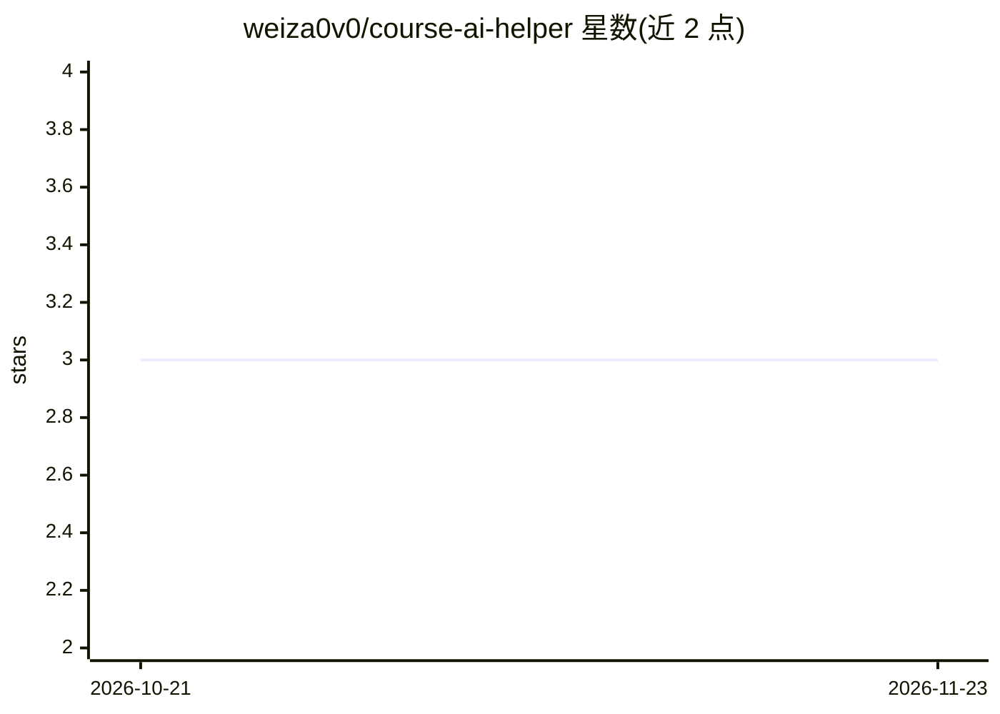

# weiza0v0/course-ai-helper

⭐ 3 · JavaScript · MIT · 推送 2026-10-24 · [GitHub](https://github.com/weiza0v0/course-ai-helper) · 个人维护 · 中文 README

**给网课学生：AI 读题解题并自动填回页面，永不交卷**

Node 脚本，通过 CDP 驱动用户已登录的浏览器读取课程作业题目，调用 OpenAI 兼容接口的多模态模型解题，答案自动勾回页面或打印到终端，代码中无任何提交动作。数值计算走自研本地数学引擎（matrix/calculus/stats/calc），经 106 项与 numpy/scipy/sympy 交叉验证。支持中国大学MOOC、超星学习通（自动填答）与智慧树（仅只读打印）。Windows 附带便携 node.exe，零 npm 依赖解压即用；其它平台 git clone 后用 node 运行。使用前提是配置支持图片输入的模型的 api_key，且声明有监考/人脸识别的考试勿用。

## 筛选速览

| 维度 | 判定 | 备注 |
|---|---|---|
| AI 角色 | `ai-native` | 本体是模型或模型工具 |
| 许可风险 | `permissive` | MIT |
| 部署形态 | `desktop` | 安装包/桌面程序 |
| 模型依赖 | — | README 未给出锁定关系 |
| 硬件要求 | — | 无带数字的原话,不猜 |
| 安装摩擦 | `low` | 无编译、无系统依赖或容器化 |
| 成熟度 | — | 结构信号不足 |

## 能力要点

- 数值结论必须过本地工具复核：自研零依赖数学引擎，106 项对照 numpy/scipy/sympy 交叉验证
- 永不自动交卷：代码中无提交点击，交卷按钮仅圈红提示
- 三个平台三种适配：页面脚本注入、iframe 穿透+字体反爬截图、CDP 只读
- 思考强度按题分档与稳定前缀缓存，附每次运行的真实用量与花费估算

## 适用场景

- 做中国大学MOOC/超星学习通的章节测验时让 AI 读题并勾选答案
- 智慧树作业只读出卷，答案自己填
- 需要图片题干读题与数理计算复核的课程答题

## 场景标签

`浏览器自动化` · 领域:效率与自动化

## 证据(README 行号)

> L3: **在线课程 AI 答题助手** · 终端一条命令：读题 → 大模型解题 → 答案填回页面（或打在终端）
> L15: 一个 Node 脚本，通过 CDP 驱动**你已经登录的浏览器**：
> L17: - 题目是图片也能做（多模态）

## 星数曲线

2026-10-21 3 → 2026-11-23 3（+0）

---
*卡片 v1 · prompt 1.4 · 生成 2026-11-21 · 置信度 mid · 依据 README sha `45a152c54b3f` · [字段定义](../../DATASET.md)*
