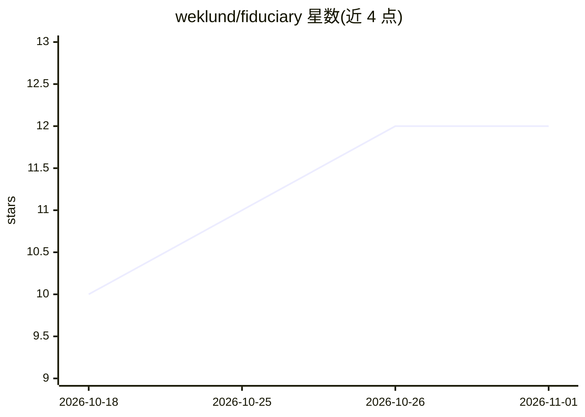

# weklund/fiduciary

⭐ 12 · Python · MIT · 推送 2026-09-27 · [GitHub](https://github.com/weklund/fiduciary) · 个人维护

**本地优先的个人财务顾问：Plaid+SQLite+LLM Agent 技能**

本地运行的个人理财顾问：通过 Plaid CLI 连接银行账户，将交易、负债、投资数据同步到本机 SQLite（可补充 Amex/Chase 等 CSV 历史账单），由 Agent Skills 兼容运行时（Claude Code、Hermes、Gemini CLI 等）加载 8 个技能命令，以对话方式基于真实数据给出理财建议。建议逻辑建立在 CFP Board 受托规划流程的分层金字塔框架上；提供隐私文档、STRIDE 威胁模型与架构文档。要求 macOS/Linux（Windows 需 WSL）、Python 3.8+、SQLite 3、Homebrew，需注册免费 Plaid 开发者账户（试用版限 10 家机构）。

## 筛选速览

| 维度 | 判定 | 备注 |
|---|---|---|
| AI 角色 | `ai-native` | 本体是模型或模型工具 |
| 许可风险 | `permissive` | MIT |
| 部署形态 | `None` |  |
| 模型依赖 | local-ok | 支持本地模型 |
| 硬件要求 | — | 无带数字的原话,不猜 |
| 安装摩擦 | `low` | 无编译、无系统依赖或容器化 |
| 成熟度 | — | 结构信号不足 |

## 能力要点

- Plaid CLI 同步 + SQLite 本地存储，数据不出机器（无云端、无遥测）
- 8 个技能命令：onboard、sync-data、finance-query、next-dollar、health-check 等
- 建议逻辑基于 CFP Board 受托规划流程的分层金字塔框架
- 支持 CSV 历史账单导入（Amex/Chase/Capital One 及通用格式）

## 适用场景

- 把我的银行交易统一到本地数据库并向 AI 顾问提问
- 获得基于我真实收支和利率的还款/留资建议
- 季度财务体检、订阅与浪费支出审计

## 场景标签

`AI 助手` · 领域:对话与助手

## 证据(README 行号)

> L8: A local-first personal finance advisor. Connects to your bank accounts, stores everything in SQLite on your machine,
> L122: **Recommended:** Commercial API key (7-day retention, no training). **Zero-trust:** Ollama locally (nothing leaves

## 星数曲线

2026-10-18 10 → 2026-11-01 12（+2）

---
*卡片 v1 · prompt 1.4 · 生成 2026-10-31 · 置信度 high · 依据 README sha `1733ae4861a9` · [字段定义](../../DATASET.md)*
