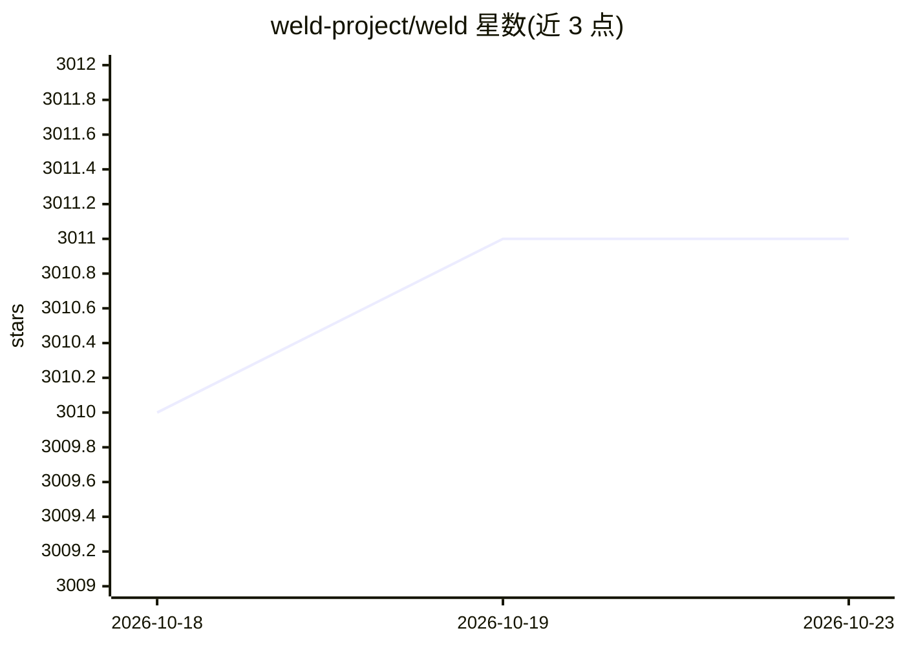

# weld-project/weld

⭐ 3,011 · Rust · BSD-3-Clause · 推送 2026-04-13 · [GitHub](https://github.com/weld-project/weld) · [官网](https://www.weld.rs) · 组织维护

**跨库优化数据分析工作流的语言与运行时**

Weld 是一种语言与运行时，面向数据密集型应用：各库的核心计算以统一中间表示表达，运行时惰性累积整个工作流的计算图，在需要结果时统一优化并求值，以减少跨函数数据搬运。以 Rust 实现，依赖 LLVM/Clang 6.0 编译构建，产出 libweld 与 libweldrt 动态库，提供 C API、Python 绑定及 Pandas 子集 Grizzly，另含 REPL 等命令行工具。由斯坦福团队维护，讨论通过其邮件列表进行。

## 筛选速览

| 维度 | 判定 | 备注 |
|---|---|---|
| AI 角色 | `ai-ecosystem` | LLM/agent 周边工具 |
| 许可风险 | `permissive` | BSD-3-Clause |
| 部署形态 | `None` |  |
| 模型依赖 | — | README 未给出锁定关系 |
| 硬件要求 | — | 无带数字的原话,不猜 |
| 安装摩擦 | `medium` | 含编译或系统依赖之一 |
| 成熟度 | — | 结构信号不足 |

## 能力要点

- 统一中间表示（Weld IR）表达各库核心计算
- 惰性构建整条工作流并在需要结果时统一优化求值
- 产出 libweld/libweldrt 动态库，提供 C API 与 Python 绑定
- Grizzly：与 Weld 集成的 Pandas 子集，附示例工作负载

## 适用场景

- 多个数据分析库组合的工作流需要减少数据搬运开销
- 通过 Python 绑定或 C API 在自有库中接入 Weld IR
- 用 REPL 检查和调试 Weld 程序

## 场景标签

`数据分析` · 领域:效率与自动化

## 证据(README 行号)

> L7: Weld is a language and runtime for improving the performance of data-intensive applications. It optimizes across lib
> L9: Modern analytics applications combine multiple functions from different libraries and frameworks to build complex wo

## 星数曲线

2026-10-18 3,010 → 2026-10-23 3,011（+1）

---
*卡片 v1 · prompt 1.4 · 生成 2026-10-20 · 置信度 mid · 依据 README sha `d4c6a563d98c` · [字段定义](../../DATASET.md)*
