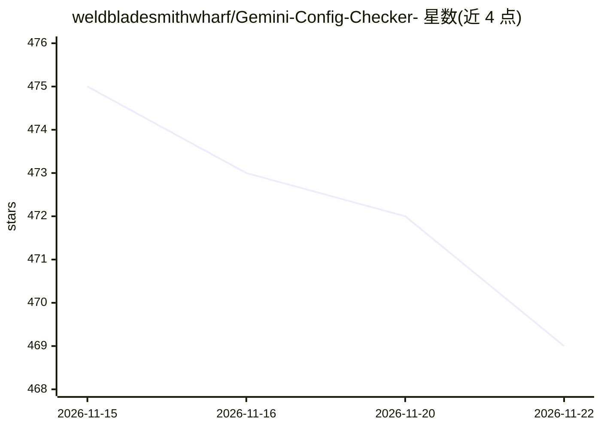

# weldbladesmithwharf/Gemini-Config-Checker-

⭐ 469 · Makefile · Apache-2.0 · 推送 2026-11-15 · [GitHub](https://github.com/weldbladesmithwharf/Gemini-Config-Checker-) · 个人维护

**扫描代理配置能否真正进入 Google AI Studio 与 Gemini 的桌面/移动工具**

面向需要通过代理访问 Google AI Studio/Gemini 的用户：批量导入 vless/vmess/trojan/ss 配置或订阅链接，用已登录 Google 账号的浏览器逐条打开目标页面读取 Google 的区域判定，区分健康/区域封锁/不可达；Simple 模式测自有配置，Advanced 模式将免费配置链在可用基础配置之后测试不同出口。内置 Xray-core 引擎与可编辑的 anti-DPI 分片配置（源自 PattN 配方），支持 Windows/macOS/Linux/Android。自述为 0.1.0 早期预发布，仅在 Windows 上完整验证过；区域检查需 Chrome/Edge/Brave，Android 仅连通性模式。

## 筛选速览

| 维度 | 判定 | 备注 |
|---|---|---|
| AI 角色 | `ai-ecosystem` | LLM/agent 周边工具 |
| 许可风险 | `permissive` | Apache-2.0 |
| 部署形态 | `desktop` | 安装包/桌面程序 |
| 模型依赖 | — | README 未给出锁定关系 |
| 硬件要求 | — | 无带数字的原话,不猜 |
| 安装摩擦 | `medium` | 含编译或系统依赖之一 |
| 成熟度 | `idea` | |

## 能力要点

- 以已登录账号的浏览器读取 Google 对 AI Studio/Gemini 的真实区域判定
- Simple/Advanced 双模式：直测配置或经基础配置链式测试免费出口
- 内置 Xray-core，支持 anti-DPI Finalmask/指纹/ALPN/密码套件可编辑配置
- 桌面端（Wails）+ Web 服务器 + Android APK 多形态发布，附 SHA256 校验

## 适用场景

- 批量测试手头哪些代理配置能真正打开 Gemini 和 AI Studio
- 基础配置能连但出口被 Google 封锁时，寻找可接受的链式出口
- 在启用 DPI 过滤的网络中调整分片参数后验证连通性

## 场景标签

 · 领域:网络工具/代理配置检测

## 证据(README 行号)

> L11: Find proxy configs that actually get you into **Google AI Studio and Gemini**, by testing each one the way a person
> L50: Google decides region availability **per signed-in account, after the page has loaded**. A plain HTTP request (even

## 星数曲线

2026-11-15 475 → 2026-11-22 469（-6）

---
*卡片 v1 · prompt 1.4 · 生成 2026-11-17 · 置信度 mid · 依据 README sha `846e83cebb20` · [字段定义](../../DATASET.md)*
