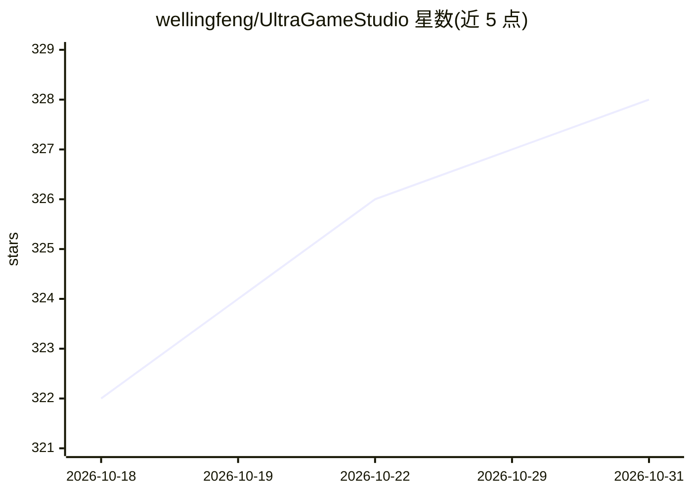

# wellingfeng/UltraGameStudio

⭐ 328 · TypeScript · MIT · 推送 2026-10-25 · [GitHub](https://github.com/wellingfeng/UltraGameStudio) · 个人维护 · 中文 README

**面向游戏开发的 AI 编程 agent，含全类游戏资产生成**

基于 Claude Code / Codex / Gemini 风格 agent 的游戏开发桌面工具：内置 40+ 游戏开发专家角色，覆盖 Unity/Unreal/Godot/Web 引擎概念，在聊天中生成玩法代码并产出图像、3D 模型、精灵动画、音频、绑定、视频等资产。支持 20+ 远程免费/低成本渠道及 Ollama、LM Studio、llama.cpp 等本地运行时，内置 Auto 多通道自动切换与 /studio 动态工作流（并行子 agent 与验收门）。会话、密钥与历史均本地存储，无需托管服务器。通过 npm 从源码运行，或用脚本打包桌面安装包。

## 筛选速览

| 维度 | 判定 | 备注 |
|---|---|---|
| AI 角色 | `ai-native` | 本体是模型或模型工具 |
| 许可风险 | `permissive` | MIT |
| 部署形态 | `desktop` | 安装包/桌面程序 |
| 模型依赖 | local-ok | 支持本地模型 |
| 硬件要求 | — | 无带数字的原话,不猜 |
| 安装摩擦 | `low` | 无编译、无系统依赖或容器化 |
| 成熟度 | — | 结构信号不足 |

## 能力要点

- 同一聊天会话内生成并管理图像/3D 模型/精灵/音频/绑定/视频等游戏资产
- 40+ 游戏开发专家角色，覆盖 Unity/Unreal/Godot/Web 引擎
- 20+ 免费或低成本渠道加 Ollama/LM Studio/llama.cpp 本地运行时，Auto 通道自动切换
- /studio 按任务生成执行 harness，含并行子 agent、对抗验证与运行日志

## 适用场景

- 在游戏引擎项目中用对话生成玩法代码与引擎集成逻辑
- 在编码会话内直接生成贴图、3D 道具、BGM、配音等资产
- 通过免费或本地模型渠道控制 AI 调用成本
- 用 /studio 拆解并自动执行多步骤复杂编码任务

## 场景标签

`编码 Agent` `图像生成` `语音合成` · 领域:编码与开发

## 证据(README 行号)

> L5:  The AI coding agent built for game development.
> L10:  around that reality: it understands game-engine concepts, generates the full range
> L80: - **Generates every asset type a game needs.** Images, 3D models, 2D sprite animation, sprite atlases, audio, skele

## 星数曲线

2026-10-18 322 → 2026-10-31 328（+6）

---
*卡片 v1 · prompt 1.4 · 生成 2026-10-21 · 置信度 high · 依据 README sha `b58fd0939815` · [字段定义](../../DATASET.md)*
