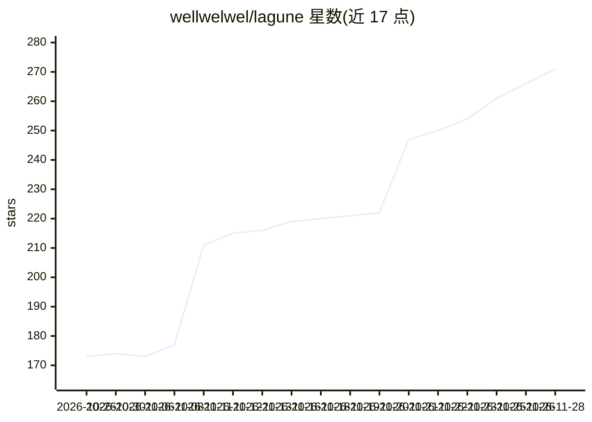

# wellwelwel/lagune

⭐ 271 · TypeScript · Apache-2.0 · 推送 2026-11-26 · [GitHub](https://github.com/wellwelwel/lagune) · [官网](https://lagune.ai) · 个人维护

**给 AI 编码 Agent 的安全技能包：边开发边加固、五步蓝队审计**

以 Agent 插件/技能形式分发的安全工具集：安装后为 Claude Code、Codex 等编码 Agent 解锁一组斜杠命令，由 charter（安全规则）统一约束。提供两类流程：构建时随写随加固（/lagune），以及按序执行的四步蓝队审计（detect→plan→harden→verify），另有从文章/漏洞学习新安全专长的 /lagune-specialize 与生成防御性披露证明的 /lagune-prove。附 npx 启动的本地 Dashboard 查看发现、修复与判定。需 Node.js LTS，无需 API key。

## 筛选速览

| 维度 | 判定 | 备注 |
|---|---|---|
| AI 角色 | `ai-ecosystem` | LLM/agent 周边工具 |
| 许可风险 | `permissive` | Apache-2.0 |
| 部署形态 | `library` | 以包/库形式分发 |
| 模型依赖 | — | README 未给出锁定关系 |
| 硬件要求 | — | 无带数字的原话,不猜 |
| 安装摩擦 | `low` | 无编译、无系统依赖或容器化 |
| 成熟度 | — | 结构信号不足 |

## 能力要点

- /lagune-charter 设定项目安全规则，约束其余所有技能
- 五步蓝队审计流：detect→plan→harden→verify 依序执行
- 支持 Claude Code、Codex 及 skills.sh/GitHub CLI 通用安装
- npx lagune 启动本地 Dashboard，实时查看发现与修复，无需 node_modules

## 适用场景

- 开发新功能时让 Agent 同步做安全加固
- 对已有项目跑完整蓝队审计并逐项修复验证
- 把安全文档/漏洞资料喂给 Agent 学成新专长

## 场景标签

`网络安全` · 领域:学习与行业

## 证据(README 行号)

> L35: An AI agent running Lagune: a project charter, a secure user sign-up, and a Blue Team audit
> L119: Once installed, your **AI** agent unlocks a set of commands, all governed by the **charter**: secure new work as y
> L49: claude plugin install lagune --marketplace wellwelwel/lagune

## 星数曲线

2026-10-26 173 → 2026-11-28 271（+98）

---
*卡片 v1 · prompt 1.4 · 生成 2026-11-25 · 置信度 high · 依据 README sha `5041d3fb5b01` · [字段定义](../../DATASET.md)*
