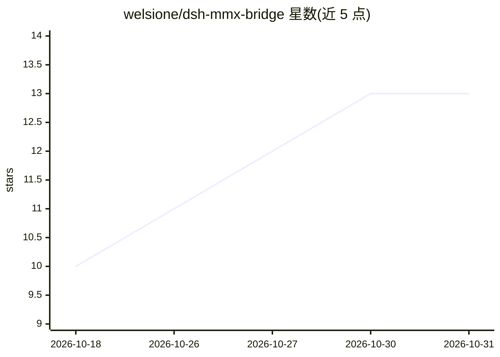

# welsione/dsh-mmx-bridge

⭐ 13 · JavaScript · MIT · 推送 2026-09-18 · [GitHub](https://github.com/welsione/dsh-mmx-bridge) · [官网](https://www.npmjs.com/package/dsh-mmx-bridge) · 个人维护 · 中文 README

**给 DeepSeek Harness 接入 MiniMax 全套多模态能力的插件**

面向 DeepSeek Harness（DSH）的插件：通过单一 mmx_bridge 工具按 action 分发，为纯文本模型接入 MiniMax 的图片理解、文生图、文/图生视频、语音合成、音乐生成、音频翻唱、联网搜索与用量查询 8 种能力。图片桥把拖入/粘贴的图片落盘替换为地址文本，使不支持图片输入的模型可识别图片；识别结果以内嵌 JSON 写回图片副本缓存复用。依赖 mmx-cli，插件提供发现/安装/登录闭环。macOS/Linux 一等支持，Windows 尽力支持且未经真机验证；缓存为明文。

## 筛选速览

| 维度 | 判定 | 备注 |
|---|---|---|
| AI 角色 | `ai-ecosystem` | LLM/agent 周边工具 |
| 许可风险 | `permissive` | MIT |
| 部署形态 | `desktop` | 安装包/桌面程序 |
| 模型依赖 | locked-api |  |
| 硬件要求 | — | 无带数字的原话,不猜 |
| 安装摩擦 | `low` | 无编译、无系统依赖或容器化 |
| 成熟度 | `idea` | |

## 能力要点

- 单一 mmx_bridge 工具按 action 分发 8 种 MiniMax 多模态能力
- 图片桥：拖图直发，纯文本模型可看图，消息原样显示
- 识别结果内嵌 JSON（PNG tEXt/JPEG COM）写回图片，同图同问零 VLM 调用复用
- mmx-cli 发现/配置/安装/API-key 登录全闭环，含 Agent 自助修复工具

## 适用场景

- 让 DSH 的纯文本模型具备看图、画图、生视频、语音等能力
- 在 DSH 对话中拖入图片直接提问而无需改输入方式
- 复用图片识别缓存减少重复 VLM 调用

## 场景标签

`多模态` `图像生成` `视频生成` `语音合成` · 领域:内容生成

## 证据(README 行号)

> L19: DSH 默认只支持纯文本对话——**看不了图、画不了画、说不了话、做不了视频**。`dsh-mmx-bridge` 通过一个 `mmx_bridge` 工具接入 MiniMax 全栈多模态模型，一次安装，8 种能力即开即用：
> L32: |运行时依赖|Node 内置模块 + `@deepseek-ai` 生态 peer 包（宿主运行时提供），无第三方运行时依赖|

## 星数曲线

2026-10-18 10 → 2026-10-31 13（+3）

---
*卡片 v1 · prompt 1.4 · 生成 2026-10-31 · 置信度 high · 依据 README sha `cd666b1744f7` · [字段定义](../../DATASET.md)*
