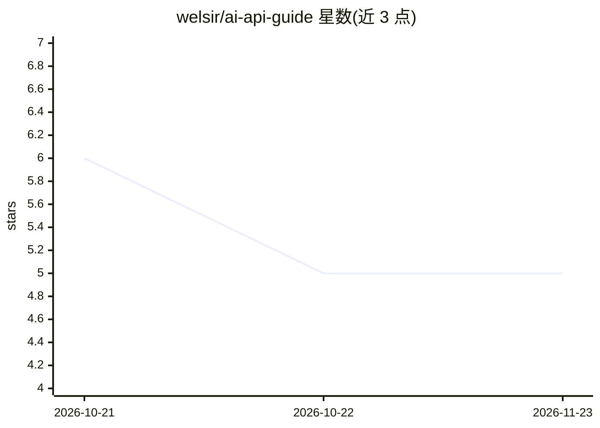

# welsir/ai-api-guide

⭐ 5 · MIT · 推送 2026-10-19 · [GitHub](https://github.com/welsir/ai-api-guide) · [官网](https://orbiorbi.com/) · 组织维护 · 中文 README

**面向开发者的 AI API 模型选型、价格与接入排错指南**

由商业 API 平台 Orbis 维护的指南文档，内容覆盖 API 服务选型维度、模型家族选型问题清单（Claude/GPT/Gemini/DeepSeek/Kimi/Qwen/GLM）、Claude Code/Codex/Cline/Cursor 等客户端与 Dify/n8n/LangChain 等工具的接入配置要点、OpenAI 兼容协议迁移检查清单、token 成本计算方法与常见错误排错表。文中包含 Orbis 线路的公开报价表与调用示例（Python 标准库/Node.js fetch/cURL），并声明选型方法适用于其他服务、非第三方独立排名。

## 筛选速览

| 维度 | 判定 | 备注 |
|---|---|---|
| AI 角色 | `ai-knowledge` | 知识聚合/清单类 |
| 许可风险 | `permissive` | MIT |
| 部署形态 | `None` |  |
| 模型依赖 | — | README 未给出锁定关系 |
| 硬件要求 | — | 无带数字的原话,不猜 |
| 安装摩擦 | `low` | 无编译、无系统依赖或容器化 |
| 成熟度 | — | 结构信号不足 |

## 能力要点

- 按任务维度（协议、功能、成本、可靠性、数据处理）的 API 服务选型核对表
- 覆盖 401/404/429/流式中断/工具调用失败等常见错误的排错表
- 含缓存、重试、多轮上下文的成本漏算检查与计费算例
- AI 网关、编程客户端、工作流框架、评估与本地推理工具的导航目录

## 适用场景

- 给 Claude Code、Codex 或 Cline 接入第三方模型前核对协议与配置
- 比较不同模型和线路的 token 成本，估算批量调用预算
- 从一家 API 服务迁移到另一家时逐项验证端点与能力
- 排查 401、404、429 等调用错误与流式中断问题

## 场景标签

`教程课程` · 领域:学习与行业

## 证据(README 行号)

> L5: A practical guide to **AI API providers, LLM model selection, API pricing and cost comparison, OpenAI-compatible end
> L9: 这里整理 AI API、LLM API 与 API 中转服务的选型方法、模型家族、客户端配置要点、调用成本和常见错误。由 **Orbis** 维护；Orbis 是提供多模型、多线路接入的商业 API 平台。文中的选型方法也适用于其他
> L56: ## API 服务选型 / Choosing an AI API Provider

## 星数曲线

2026-10-21 6 → 2026-11-23 5（-1）

---
*卡片 v1 · prompt 1.4 · 生成 2026-11-21 · 置信度 high · 依据 README sha `04e86c9e8aad` · [字段定义](../../DATASET.md)*
