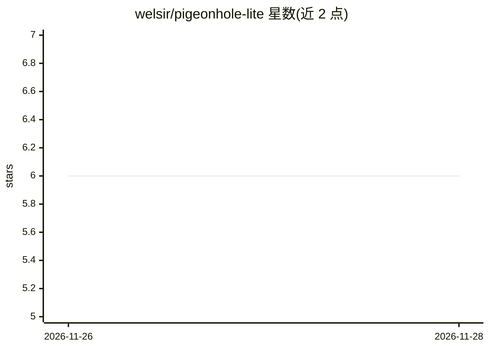

# welsir/pigeonhole-lite

⭐ 6 · JavaScript · NOASSERTION · 推送 2026-11-25 · [GitHub](https://github.com/welsir/pigeonhole-lite) · [官网](https://chromewebstore.google.com/detail/pigeonhole/ikjdcjgnlbealhahlogjidahhhlbcdhp?hl=zh-CN) · 个人维护 · 中文 README

**给浏览器下载用户自动重命名并按项目归档文件的扩展**

Chrome 与 Edge 扩展，在下载时结合来源网页文字为附件命名，并通过规则、浏览器标签组或 AI 建议将文件归入项目文件夹；支持网页右上角卡片实时调整去向、撤销本批、从单条记录生成规则，并提供按网页标题、链接文字、时间与类型的本机离线搜索及 AI 自然语言找回。文件内容不上传，不申请 history 权限，AI 功能可试用内置额度或填入自有 OpenAI 兼容 API Key 直连。仓库公开 Lite 版源码，完整版经商店分发。

## 筛选速览

| 维度 | 判定 | 备注 |
|---|---|---|
| AI 角色 | `ai-enhanced` | 去掉 AI 部分产品仍成立 |
| 许可风险 | `none` | NOASSERTION |
| 部署形态 | `None` |  |
| 模型依赖 | — | README 未给出锁定关系 |
| 硬件要求 | — | 无带数字的原话,不猜 |
| 安装摩擦 | `low` | 无编译、无系统依赖或容器化 |
| 成熟度 | — | 结构信号不足 |

## 能力要点

- 结合下载链接附近文字为多个附件分别命名
- 按规则、标签组或 AI 建议归入项目文件夹，支持规则试算与优先级排序
- 按网页线索本机离线搜索找回，「AI 帮我找」发送脱敏候选摘要
- 支持填入自有 OpenAI 兼容 API Key 或接入本地模型

## 适用场景

- 批量下载采购公告、论文等编号式附件时自动命名归档
- 多个项目的资料分散在不同网站时统一归入各项目文件夹
- 忘记文件名时凭网页标题或时间线索找回下载

## 场景标签

 · 领域:效率工具/浏览器扩展

## 证据(README 行号)

> L5:  在 Chrome 或 Edge 下载论文、采购附件、报表或设计素材时，文件鸽会趁网页还没关，结合来源页面给文件起名，按规则、标签组或 AI 建议把它放进项目文件夹；隔几天忘了文件名，也能凭当时的网页线索找回来。
> L121: 无需注册即可直接试用内置 AI（设体验与每日上限）。如果在设置中填入你自己的 DeepSeek、硅基流动等 OpenAI 兼容 API Key 或接入本地模型，AI 起名、AI 帮我找和一句话建规则全部免费且不限次数，请求直接发
> L123: 本仓库公开文件鸽 Lite 版源码；完整版可从 Chrome 应用商店 或 Microsoft Edge 加载项 免费安装。

## 星数曲线

2026-11-26 6 → 2026-11-28 6（+0）

---
*卡片 v1 · prompt 1.4 · 生成 2026-11-26 · 置信度 high · 依据 README sha `5190fcdff95f` · [字段定义](../../DATASET.md)*
