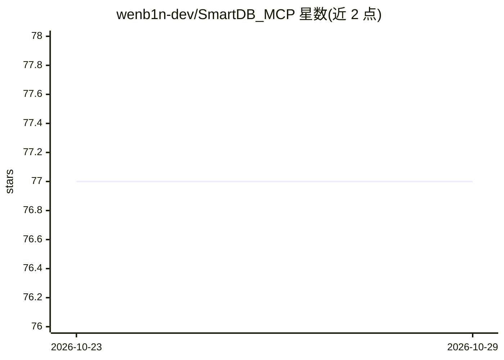

# wenb1n-dev/SmartDB_MCP

⭐ 77 · Python · MIT · 推送 2026-10-23 · [GitHub](https://github.com/wenb1n-dev/SmartDB_MCP) · 个人维护 · 中文 README

**连接 10 种数据源的通用数据库 MCP 服务器**

实现 Model Context Protocol 服务器接口的多范式数据基础设施网关：覆盖关系型数据库（MySQL/PostgreSQL/Oracle/SQL Server/达梦）、Redis、MongoDB、Milvus 向量库、Elasticsearch 与 Kafka，共 26 个 MCP 工具，按连接池范式动态暴露。附加 OAuth 2.0 认证、健康检查、SQL 优化与索引健康检测；支持 readonly/writer/admin 三级角色权限。提供 pip 安装、Docker 与 uv 源码三种启动方式，支持 stdio/sse/streamablehttp 三种传输模式。

## 筛选速览

| 维度 | 判定 | 备注 |
|---|---|---|
| AI 角色 | `ai-ecosystem` | LLM/agent 周边工具 |
| 许可风险 | `permissive` | MIT |
| 部署形态 | `self-host` | docker 或自建部署 |
| 模型依赖 | — | README 未给出锁定关系 |
| 硬件要求 | — | 无带数字的原话,不猜 |
| 安装摩擦 | `low` | 无编译、无系统依赖或容器化 |
| 成熟度 | — | 结构信号不足 |

## 能力要点

- 6 种数据范式、10 种数据源、26 个 MCP 工具，按范式动态暴露
- OAuth 2.0 认证（streamablehttp 模式）与三级角色权限控制
- 数据库健康诊断、SQL 优化与索引健康检测工具
- 支持 pip / Docker / uv 源码启动及三种传输模式

## 适用场景

- 让 MCP 客户端（如 Cursor、Cline）统一访问多种数据库
- 通过 AI 客户端执行 SQL 优化与数据库健康诊断
- 以角色权限管控 AI 对数据库的读写操作

## 场景标签

`数据分析` · 领域:效率与自动化

## 证据(README 行号)

> L9: SmartDB is a universal multi-paradigm data-infrastructure gateway that implements the Model Context Protocol (MCP) s
> L11: It currently covers **6 data paradigms and 10 data sources**: 5 relational databases (MySQL, PostgreSQL, Oracle, SQ

## 星数曲线

2026-10-23 77 → 2026-10-29 77（+0）

---
*卡片 v1 · prompt 1.4 · 生成 2026-10-24 · 置信度 high · 依据 README sha `aca90a4bd45b` · [字段定义](../../DATASET.md)*
