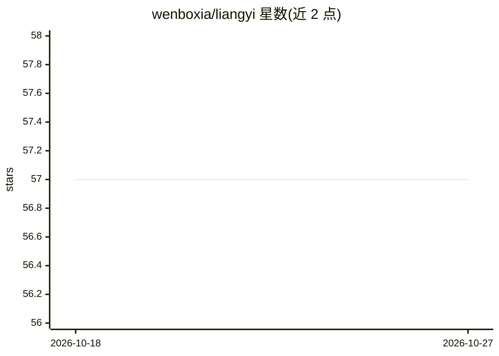

# wenboxia/liangyi

⭐ 57 · Python · MIT · 推送 2026-09-29 · [GitHub](https://github.com/wenboxia/liangyi) · [官网](https://liangyi-five.vercel.app) · 个人维护 · 中文 README

**跨厂商多 Agent 工作流：用对抗批判链把产品想法打磨成方案**

输入一个产品想法，经 13 步确定性编排产出方案 v5：7 个上下文隔离的角色 Agent 分属三个模型槽位（按底模坐标跨厂商分配），流程为忠实重述 → 对立专家互不可见出方案并融合 → 投资人批判 → 零上下文单盲复审 → 漂移诊断 → 前提拆台，按论据严重度路由三个出口，最多两轮。提供 auto 与 HITL 人工判断两档，断点续跑，每步 trace 记录 token 与成本。限制：开跑前校验 3 条硬规则，第 2 轮前累计花费达 $3 不再开；需 Python 3.10+ 并配置多家模型 API key。提供在线入口与命令行两种运行方式。

## 筛选速览

| 维度 | 判定 | 备注 |
|---|---|---|
| AI 角色 | `ai-native` | 本体是模型或模型工具 |
| 许可风险 | `permissive` | MIT |
| 部署形态 | `library` | 以包/库形式分发 |
| 模型依赖 | locked-api |  |
| 硬件要求 | — | 无带数字的原话,不猜 |
| 安装摩擦 | `low` | 无编译、无系统依赖或容器化 |
| 成熟度 | — | 结构信号不足 |

## 能力要点

- 13 步确定性编排，7 个角色 Agent 按底模坐标跨厂商分配槽位
- 单盲窗口零上下文由代码强制（显式注入历史抛 ZeroContextViolation）
- 2 个 HITL 必停点（漂移回退、拆台判定），决定卡支持带指令重跑
- 断点续跑与每步 trace（模型、产物、token、成本、推理过程）

## 适用场景

- 把一个产品想法走完整批判链，得到经过四轮独立批判的方案
- 在方案返工前发现方向漂移与前提错误
- 对照 v1 到 v5 的逐条修改理由审查方案演进

## 场景标签

`多智能体` `工作流自动化` · 领域:Agent 开发

## 证据(README 行号)

> L20: 一个产品想法进去，一份经过四轮独立批判的方案出来。7 个上下文互相隔离的角色 Agent 分属三家厂商、按底模坐标分工：想法先被忠实重述，两位对立专家互不可见地各出方案并融合，再依次经过投资人批判 → 零上下文单盲复审 → 方向漂
> L62: 对抗式方案生成 → 四轮独立批判 → 分级判定与路由；7 个角色 Agent 按底模坐标分到三个模型槽位。

## 星数曲线

2026-10-18 57 → 2026-10-27 57（+0）

---
*卡片 v1 · prompt 1.4 · 生成 2026-10-24 · 置信度 mid · 依据 README sha `b31c6202268c` · [字段定义](../../DATASET.md)*
