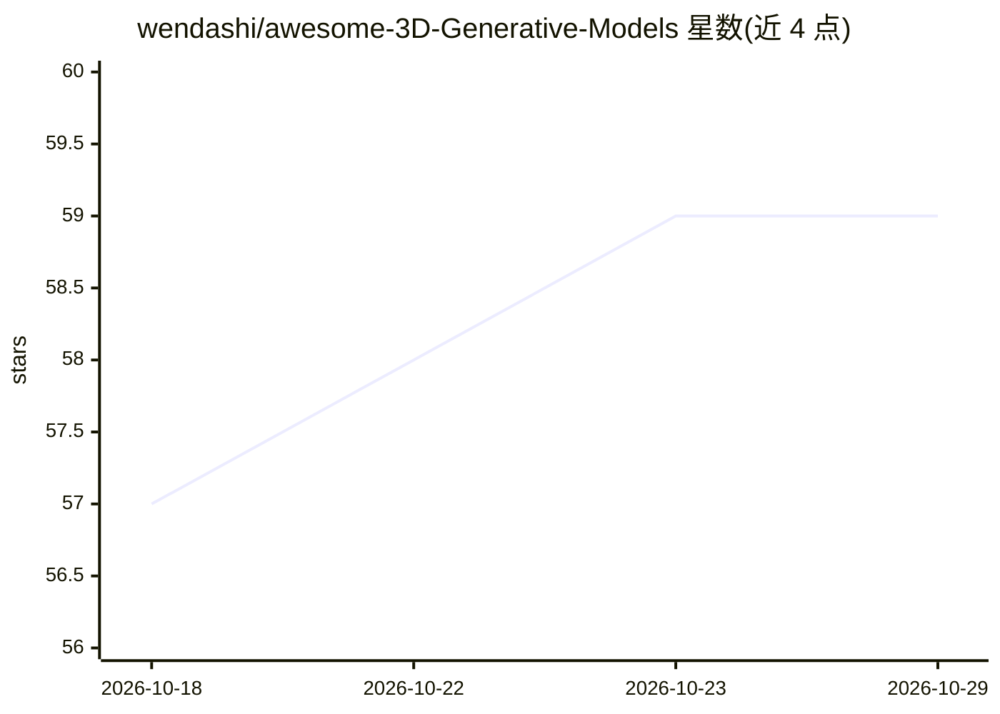

# wendashi/awesome-3D-Generative-Models

⭐ 59 · 推送 2026-10-15 · [GitHub](https://github.com/wendashi/awesome-3D-Generative-Models) · 个人维护

**3D 生成模型论文与项目策展清单**

面向 3D 生成方向研究者的 awesome 类清单：按 3D 制作管线组织条目，覆盖 3D 表示、网格重建 VAE、Flow-matching DiT 网格与纹理生成、重拓扑、UV 展开、纹理生成、绑定与动画、生成加速、后训练对齐，以及 3D 场景生成（世界模型，分开源/闭源）。每条目附论文发表信息与 GitHub 仓库链接、星标徽章，部分条目收录训练代码与数据集信息。本体为纯清单，不提供安装或运行方式。

## 筛选速览

| 维度 | 判定 | 备注 |
|---|---|---|
| AI 角色 | `ai-knowledge` | 知识聚合/清单类 |
| 许可风险 | `none` | — |
| 部署形态 | `None` |  |
| 模型依赖 | — | README 未给出锁定关系 |
| 硬件要求 | — | 无带数字的原话,不猜 |
| 安装摩擦 | `low` | 无编译、无系统依赖或容器化 |
| 成熟度 | — | 结构信号不足 |

## 能力要点

- 按 3D 动画管线（建模→纹理→动画）分类组织条目
- 收录网格生成、UV 展开、PBR 纹理、物理动画等环节的模型与研究
- 含生成加速（FlashVDM）与后训练对齐（RL/DPO）专题
- 3D 场景生成（世界模型）区分开源与闭源条目

## 适用场景

- 查找文本/图像转 3D 的生成模型与开源实现
- 按制作管线环节定位网格重建、纹理、绑定动画相关研究
- 跟踪世界模型与 3D 场景生成的开源进展

## 场景标签

`精选清单` `图像生成` · 领域:内容生成

## 证据(README 行号)

> L1: awesome Maintenance PR's Welcome
> L4: # awesome 3D Generative Models
> L15: ## Review

## 星数曲线

2026-10-18 57 → 2026-10-29 59（+2）

---
*卡片 v1 · prompt 1.4 · 生成 2026-10-24 · 置信度 high · 依据 README sha `051cbae712d9` · [字段定义](../../DATASET.md)*
