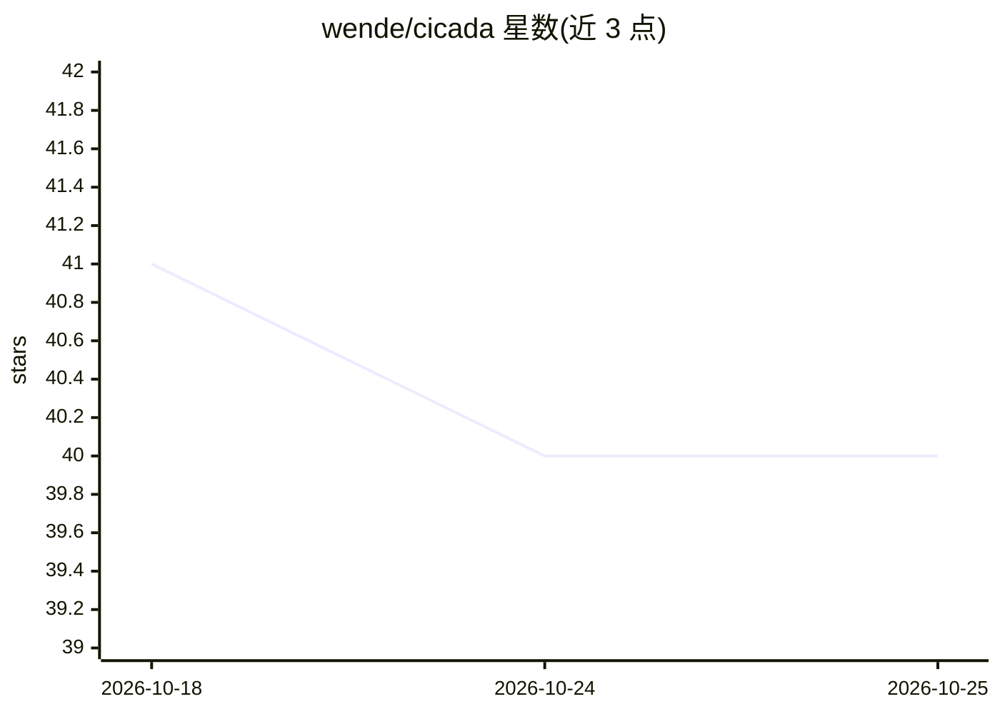

# wende/cicada

⭐ 40 · Python · MIT · 推送 2026-09-20 · [GitHub](https://github.com/wende/cicada) · [官网](https://cicada-mcp.vercel.app/) · 个人维护

**面向 AI 编程助手的本地代码索引与 MCP 上下文压缩服务器**

本地优先的代码智能索引工具：对 Elixir、Python、TypeScript、Rust 等 17+ 语言做 AST 级索引，提取模块/函数/类定义、签名与调用点，通过 7 个 MCP 工具（query、search_module、search_function、git_history 等）供 Claude、Cursor、VS Code、Gemini、Codex 等编辑器中的 AI 助手调用，替代 grep 式全文输出以节省 token。支持关键词或 Ollama embeddings 语义搜索、GitHub PR 归因、watch 模式增量重索引。解析与索引全部本地完成，无遥测。注意：README 顶部声明项目已停止维护，作者建议不再使用。

## 筛选速览

| 维度 | 判定 | 备注 |
|---|---|---|
| AI 角色 | `ai-ecosystem` | LLM/agent 周边工具 |
| 许可风险 | `permissive` | MIT |
| 部署形态 | `None` |  |
| 模型依赖 | local-ok | 支持本地模型 |
| 硬件要求 | — | 无带数字的原话,不猜 |
| 安装摩擦 | `low` | 无编译、无系统依赖或容器化 |
| 成熟度 | — | 结构信号不足 |

## 能力要点

- AST 级索引覆盖 17+ 语言，返回签名与调用点而非全文
- MCP 服务器提供 7 个只读工具，一条命令接入多种编辑器 AI 助手
- 语义搜索可选 Ollama embeddings 模式
- Git/PR 归因与双向依赖分析（what_calls_it / what_it_calls）

## 适用场景

- 让编辑器里的 AI 编程助手用更少 token 获取代码上下文
- 跨 Elixir/Python 等多语言混合仓库做函数级检索
- 追溯某行代码由哪个 PR 引入及评审讨论

## 场景标签

`语义搜索` · 领域:知识与检索

## 证据(README 行号)

> L8: **Context compaction for AI code assistants** – Give your AI structured, token-efficient access to 17+ languages inc
> L48: - **Semantic search** – Find code by concept with keyword extraction or embeddings (Ollama integration)

## 星数曲线

2026-10-18 41 → 2026-10-25 40（-1）

---
*卡片 v1 · prompt 1.4 · 生成 2026-10-25 · 置信度 high · 依据 README sha `e47d9eb6939f` · [字段定义](../../DATASET.md)*
