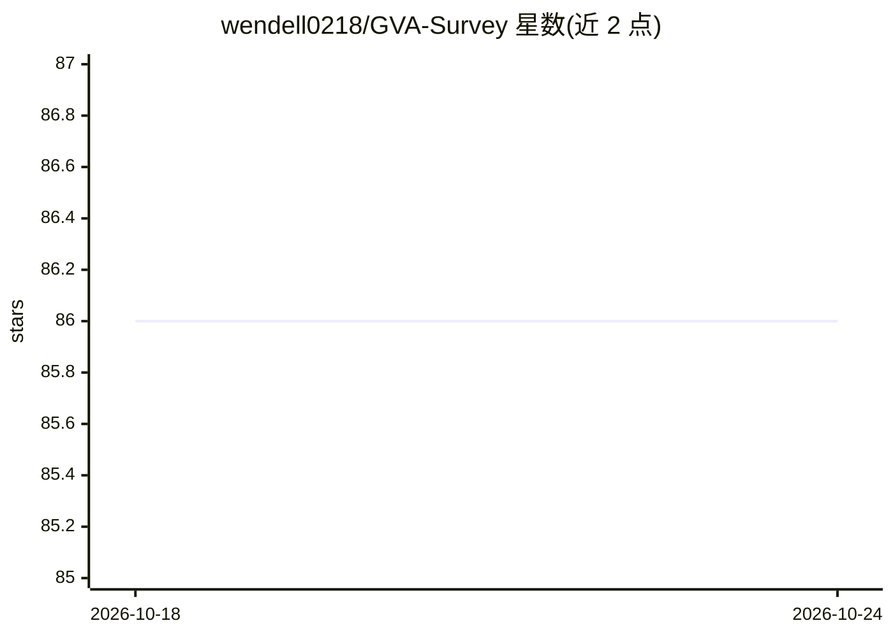

# wendell0218/GVA-Survey

⭐ 86 · 推送 2026-04-15 · [GitHub](https://github.com/wendell0218/GVA-Survey) · [官网](https://arxiv.org/abs/2411.10943) · 组织维护 · 中文 README

**通用虚拟智能体（GVA）综述论文的官方文献仓库**

论文 "Generalist Virtual Agents: A Survey on Autonomous Agents Across Digital Platforms"（arXiv:2411.10943，浙江大学等机构作者）的配套仓库：按综述章节（环境、任务、观测空间、动作空间等）分类整理被引用论文，覆盖 Web/应用/操作系统环境下的 GUI 智能体、多模态智能体研究，提供完整引用信息；另有每日自动更新的 Related Papers 列表、中文版综述与贡献指南。面向 GVA 研究者提供文献检索入口。

## 筛选速览

| 维度 | 判定 | 备注 |
|---|---|---|
| AI 角色 | `ai-knowledge` | 知识聚合/清单类 |
| 许可风险 | `none` | — |
| 部署形态 | `None` |  |
| 模型依赖 | — | README 未给出锁定关系 |
| 硬件要求 | — | 无带数字的原话,不猜 |
| 安装摩擦 | `low` | 无编译、无系统依赖或容器化 |
| 成熟度 | — | 结构信号不足 |

## 能力要点

- 按环境/任务/观测空间/动作空间等维度分类整理被引论文
- 每日 0:30 (UTC+8) 自动收集更新 GVA 领域最新论文
- 提供中文版综述

## 适用场景

- 按主题分类查找 GUI/Web/移动端智能体研究论文
- 了解通用虚拟智能体领域的文献脉络
- 跟踪该领域每日新论文

## 场景标签

`科研工具` `精选清单` · 领域:学习与行业

## 证据(README 行号)

> L39: - **[November 17, 2024]** Our survey is available on the arXiv platform: https://arxiv.org/abs/2411.10943
> L54: Welcome to the GitHub repository for our survey paper titled *"Generalist Virtual Agents: A Survey on Autonomous Ag

## 星数曲线

2026-10-18 86 → 2026-10-24 86（+0）

---
*卡片 v1 · prompt 1.4 · 生成 2026-10-24 · 置信度 high · 依据 README sha `21a1bc3ed756` · [字段定义](../../DATASET.md)*
