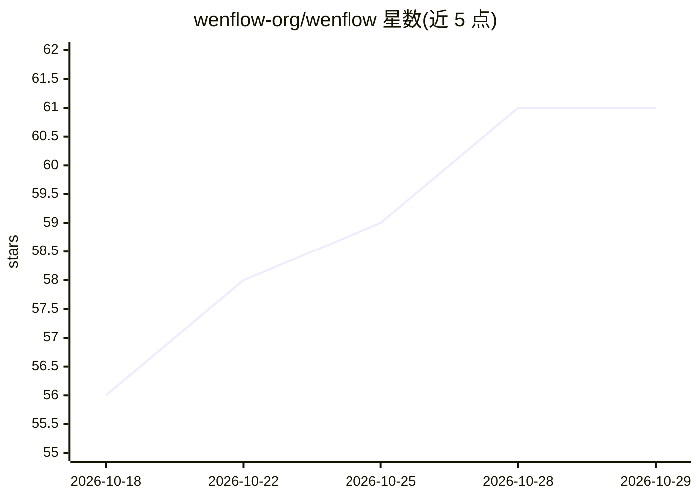

# wenflow-org/wenflow

⭐ 61 · TypeScript · MIT · 推送 2026-10-28 · [GitHub](https://github.com/wenflow-org/wenflow) · [官网](https://wenflow.org/) · 个人维护 · 中文 README

**从真实问题出发的 AI 学习平台：对话澄清目标并生成学习路径**

面向学习者的 AI 学习支持服务平台：学习者先陈述问题，多 Agent 系统通过多轮追问澄清目标，生成可执行学习路径，再进行回合式教学、课后评估与按 FSRS-6 记忆模型安排复习；以 LSS/KTL/LF/LSB 四个指标追踪学习负荷与疲劳。5 个顶层 Agent 分工协作，兼容 OpenAI 接口的模型网关（默认 deepseek-v4.1-flash），支持用户自带 API Key。另含 18 个场景页的管理后台、Prompt 设计台与虚拟学习者仿真实验室。Vue3 + Node.js + SQLite 双库，MIT 协议，可自托管。

## 筛选速览

| 维度 | 判定 | 备注 |
|---|---|---|
| AI 角色 | `ai-native` | 本体是模型或模型工具 |
| 许可风险 | `permissive` | MIT |
| 部署形态 | `desktop` | 安装包/桌面程序 |
| 模型依赖 | locked-api |  |
| 硬件要求 | — | 无带数字的原话,不猜 |
| 安装摩擦 | `low` | 无编译、无系统依赖或容器化 |
| 成熟度 | — | 结构信号不足 |

## 能力要点

- 多 Agent 分工的目标澄清→路径生成→回合式教学闭环，路径变更需学习者确认
- LSS/KTL/LF/LSB 学习负荷指标与疲劳提醒
- 按 FSRS-6 记忆模型安排跨天复习
- 内置 Virtual Learner Lab 虚拟学习者仿真与 18 个场景页管理后台

## 适用场景

- 我有一个模糊想学的目标，希望 AI 帮我澄清并拆成可执行的学习路径
- 我想按回合式上课并获得即时反馈和课后评估
- 我想追踪自己的学习强度与疲劳状态，避免过度学习
- 我想自托管一个带管理后台的 AI 学习平台给自己或小团体用

## 场景标签

`多智能体` · 领域:Agent 开发

## 证据(README 行号)

> L7: **一款从真实问题出发的 AI 学习支持服务平台**
> L65: ### 1. 真正在“上课”的多 Agent 课堂
> L145: WenFlow 由个人独立研发，自 2026 年 4 月首个版本起持续迭代；功能验证以内置的 AI 虚拟学习者实验室为主，公开演示站（wenflow.org）可在线体验完整闭环。

## 星数曲线

2026-10-18 56 → 2026-10-29 61（+5）

---
*卡片 v1 · prompt 1.4 · 生成 2026-10-24 · 置信度 high · 依据 README sha `8d1b426cbac4` · [字段定义](../../DATASET.md)*
