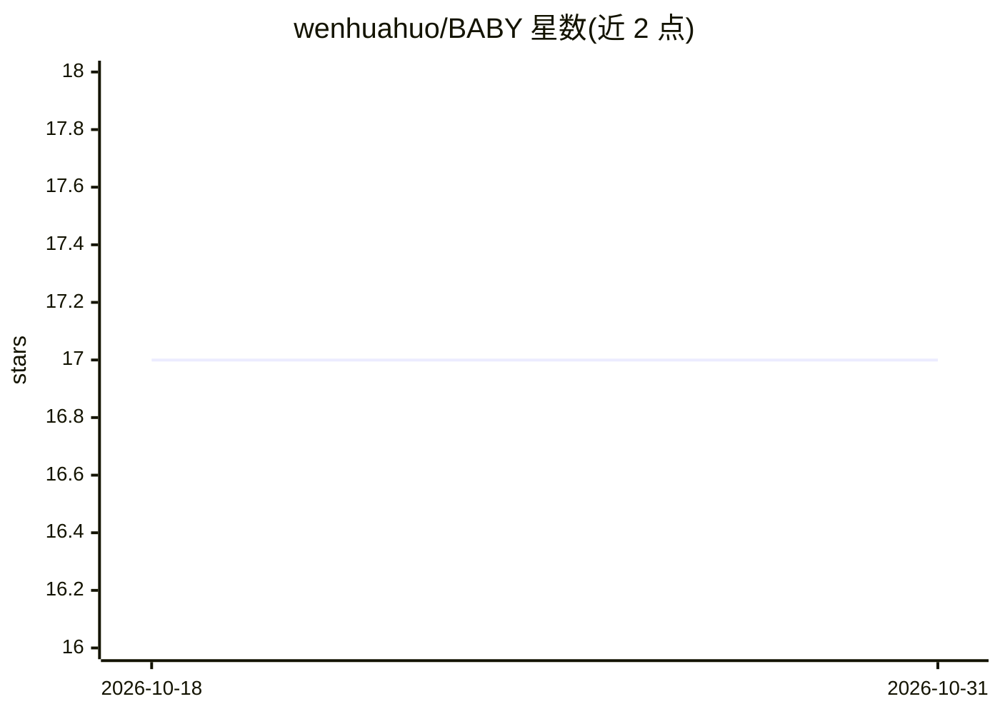

# wenhuahuo/BABY

⭐ 17 · TypeScript · MIT · 推送 2026-08-28 · [GitHub](https://github.com/wenhuahuo/BABY) · 个人维护 · 中文 README

**把个人真实工作转为本地 agent 基准的评测框架**

面向个人（如博士研究者）的 agent 基准构建工具：从本地素材——agent 会话日志（OpenCode/Pi）、git 提交历史、代码项目与文档——抽取评测任务，打包为四类任务（code-dev/proposal-writing/idea-extraction/research-survey），在本地对任意 agent harness 跑 Task×Pairing×Repeat 矩阵，用可执行验证（代码测试/行为检查）或锁定的 rubric judge 统一评分，全程在本地 web 工作区完成，数据不出本机。要求 Node.js 20+，评分/抽取使用任意 OpenAI 兼容 API（默认 DeepSeek）。

## 筛选速览

| 维度 | 判定 | 备注 |
|---|---|---|
| AI 角色 | `ai-ecosystem` | LLM/agent 周边工具 |
| 许可风险 | `permissive` | MIT |
| 部署形态 | `library` | 以包/库形式分发 |
| 模型依赖 | locked-api |  |
| 硬件要求 | — | 无带数字的原话,不猜 |
| 安装摩擦 | `low` | 无编译、无系统依赖或容器化 |
| 成熟度 | — | 结构信号不足 |

## 能力要点

- 从会话日志、git 历史、代码项目与文档抽取评测任务
- 四类任务型：code-dev/proposal-writing/idea-extraction/research-survey
- 可执行验证 + 锁定 rubric judge（证据锚定、分歧仲裁、kappa≥0.7 校准）
- 本地 web 工作区覆盖抽取→打包→门控→跑分→报告全流程，数据全部留在本地

## 适用场景

- 用自己日常工作素材评测不同 LLM+agent harness 组合
- 科研/开发场景下挑选适合自己工作流的模型
- 本地构建与运行私有基准，不外泄数据

## 场景标签

`模型评测` · 领域:评测与运维

## 证据(README 行号)

> L16: BABY extracts evaluation tasks from your own material — agent chat logs (OpenCode/Pi etc.),
> L18: runs benchmarks against any agent harness on your machine, graded uniformly by
> L19: **executable verification** (code tests, behavior checks) or a **locked rubric judge**.

## 星数曲线

2026-10-18 17 → 2026-10-31 17（+0）

---
*卡片 v1 · prompt 1.4 · 生成 2026-10-29 · 置信度 high · 依据 README sha `d7273967a6b8` · [字段定义](../../DATASET.md)*
