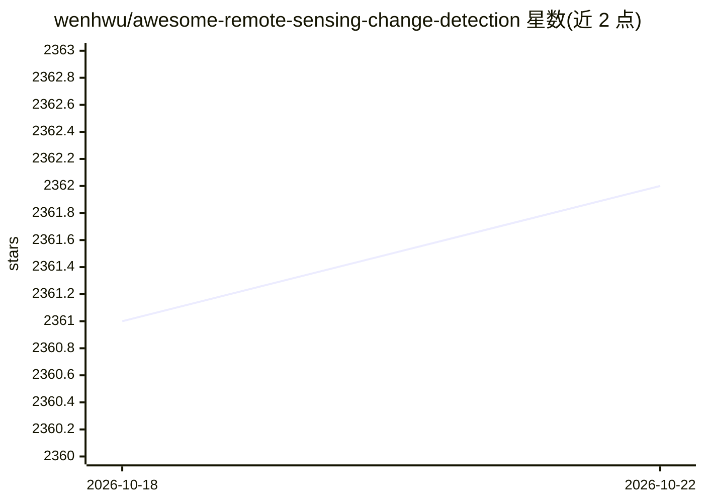

# wenhwu/awesome-remote-sensing-change-detection

⭐ 2,362 · 推送 2026-09-09 · [GitHub](https://github.com/wenhwu/awesome-remote-sensing-change-detection) · 个人维护

**遥感变化检测领域的数据集、工具、方法与竞赛汇编清单**

面向遥感变化检测研究者的 awesome 类策展清单：以表格形式收录光学与多模态/SAR 数据集（含年份、任务类型、目标、影像对数量、分辨率、地点等字段，覆盖 SCD/BCD/DDA/BDA/RSICC 任务）、开源工具箱（rschange、torchange、Open-CD、PaddleRS 等）、深度学习方法（基础模型、扩散模型、Transformer、CNN）及综述论文与竞赛信息。条目附出版物与代码链接，README 以 Markdown 维护并标注 MIT 许可。

## 筛选速览

| 维度 | 判定 | 备注 |
|---|---|---|
| AI 角色 | `ai-knowledge` | 知识聚合/清单类 |
| 许可风险 | `permissive` | — |
| 部署形态 | `None` |  |
| 模型依赖 | — | README 未给出锁定关系 |
| 硬件要求 | — | 无带数字的原话,不猜 |
| 安装摩擦 | `low` | 无编译、无系统依赖或容器化 |
| 成熟度 | — | 结构信号不足 |

## 能力要点

- 光学与多模态/SAR 数据集分表编目，含年份/任务/分辨率/地点等字段
- 收录 rschange、torchange、Open-CD、PaddleRS 等开源工具箱
- 方法条目涵盖基础模型（SAM2、CLIP、DINOv3、Qwen2.5-VL 等）相关研究
- 覆盖数据集、工具、方法、综述论文与竞赛五类内容

## 适用场景

- 查找遥感变化检测可用的公开数据集及其规格
- 为变化检测研究选择开源工具箱与基线方法
- 跟踪该领域最新论文方法与竞赛动态

## 场景标签

`精选清单` · 领域:学习与行业

## 证据(README 行号)

> L1: # `Awesome Remote Sensing Change Detection`
> L4: A comprehensive and up-to-date compilation of datasets, tools, methods (including foundation models, diffusion model

## 星数曲线

2026-10-18 2,361 → 2026-10-22 2,362（+1）

---
*卡片 v1 · prompt 1.4 · 生成 2026-10-21 · 置信度 high · 依据 README sha `ca0d78fbc34a` · [字段定义](../../DATASET.md)*
