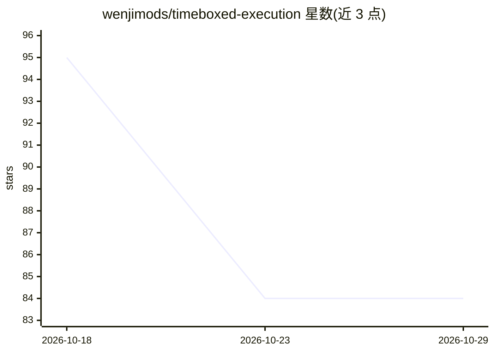

# wenjimods/timeboxed-execution

⭐ 84 · MIT · 推送 2026-08-27 · [GitHub](https://github.com/wenjimods/timeboxed-execution) · 组织维护

**给 AI agent 的时间盒执行工作流技能，防止超期与虚假完成**

遵循开放 Agent Skills 规范的单文件技能（SKILL.md），向兼容运行时（Codex、Hermes、自定义 harness）注入截止时间约束的执行流程：行动前定义可观测的完成条件、预留验证时间、到期冻结范围，并以五种完成状态之一如实报告（verified_complete/partial_verified/blocked/failed/stopped_unverified）。附验证模式参考文档与评分量规。可通过 npx skills CLI、Hermes 命令或手动复制安装；工具无关，支持 Linux/macOS/Windows。

## 筛选速览

| 维度 | 判定 | 备注 |
|---|---|---|
| AI 角色 | `ai-ecosystem` | LLM/agent 周边工具 |
| 许可风险 | `permissive` | MIT |
| 部署形态 | `library` | 以包/库形式分发 |
| 模型依赖 | — | README 未给出锁定关系 |
| 硬件要求 | — | 无带数字的原话,不猜 |
| 安装摩擦 | `low` | 无编译、无系统依赖或容器化 |
| 成熟度 | — | 结构信号不足 |

## 能力要点

- 行动前定义可观测完成条件并预留验证时间
- 到期停止规则：五种完成状态如实报告而非静默加班
- 轻量快速路径处理简单任务，复杂任务拆为可独立验收的阶段
- 附带匿名化回放案例与评分量规（references/validated-patterns.md）

## 适用场景

- 让编码 agent 在固定时限内修复 bug 并完成回归验证
- 防止 agent 范围蔓延或宣称虚假完成
- 为自定义 harness 提供过程性执行约束上下文

## 场景标签

`工作流自动化` · 领域:效率与自动化

## 证据(README 行号)

> L3: An Agent Skill that helps agents avoid deadline overruns, scope creep, skipped verification, and false completion.
> L30: The CLI detects supported agents and installs the Skill into their appropriate project-level directories. This repo
> L66: - `SKILL.md` — the reusable workflow.

## 星数曲线

2026-10-18 95 → 2026-10-29 84（-11）

---
*卡片 v1 · prompt 1.4 · 生成 2026-10-24 · 置信度 high · 依据 README sha `08389b0a2649` · [字段定义](../../DATASET.md)*
