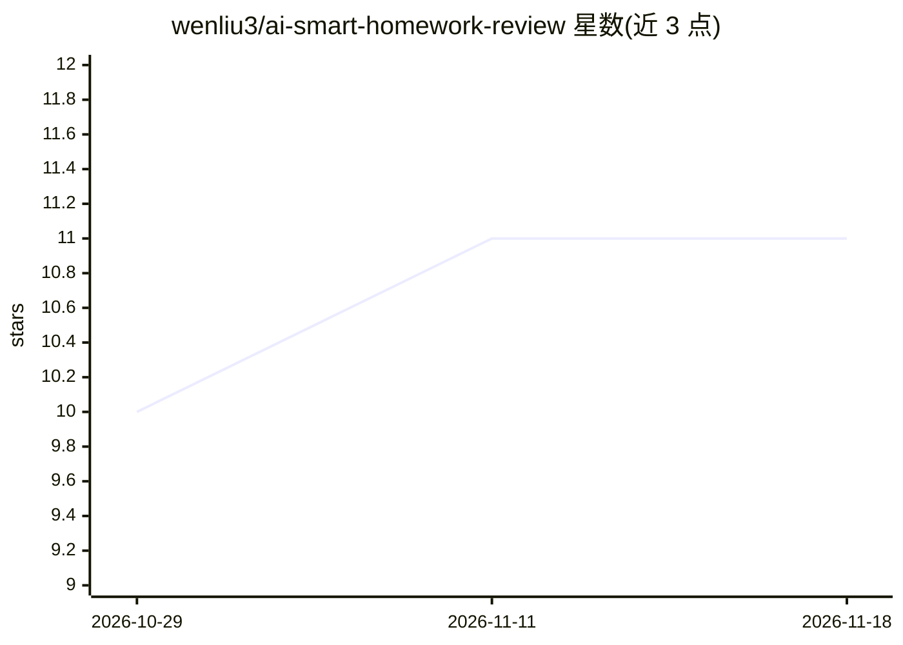

# wenliu3/ai-smart-homework-review

⭐ 11 · Python · MulanPSL-2.0 · 推送 2026-09-06 · [GitHub](https://github.com/wenliu3/ai-smart-homework-review) · 个人维护 · 中文 README

**面向教师/学生/管理员的 AI 作业批改与教学辅助平台**

基于 FastAPI、Vue 3 与 LangGraph 多智能体的全栈作业批改与教学辅助系统，提供管理员/教师/学生三种角色及各自专属 AI 助手。批改采用 Celery 异步多模态结构化评分（视觉模型逐维度输出 JSON、pydantic 校验、后端汇总总分），教师写操作走审批草案闭环，另提供文档查重（N-gram/TF-IDF/感知哈希）与操作审计。运行需 MySQL、PostgreSQL，Redis 供批改队列使用。

## 筛选速览

| 维度 | 判定 | 备注 |
|---|---|---|
| AI 角色 | `ai-native` | 本体是模型或模型工具 |
| 许可风险 | `viral` | MulanPSL-2.0 |
| 部署形态 | `self-host` | docker 或自建部署 |
| 模型依赖 | locked-api |  |
| 硬件要求 | — | 无带数字的原话,不猜 |
| 安装摩擦 | `low` | 无编译、无系统依赖或容器化 |
| 成熟度 | — | 结构信号不足 |

## 能力要点

- Celery 异步多模态结构化批改，总分由后端汇总而非模型自算，失败转人工
- 三角色 LangGraph 状态图：意图路由→专家 Agent→独立安全审核→输出
- 教师写操作只生成审批草案，SHA-256 载荷哈希 + 幂等账本五重复验
- 文档查重：N-gram 重叠 + TF-IDF 余弦相似度 + 感知哈希图片比对

## 适用场景

- 学校或班级用 AI 批改带图片与文档附件的作业
- 教师通过 AI 助手查询教学数据并起草作业变更
- 检测学生作业之间的文本与截图复制
- 为学生提供不直接给答案的启发式学习辅导

## 场景标签

`AI 助手` · 领域:对话与助手

## 证据(README 行号)

> L3: > 基于 **FastAPI + Vue 3 + LangGraph 多智能体** 的全栈 AI 作业批改与教学辅助平台。三种角色（管理员/教师/学生）各自拥有专属 AI 助手；作业批改采用 Celery 异步多模态结构化批改（De
> L32: |LangChain 1.x + LangGraph|多智能体编排（StateGraph + 结构化输出契约）|
> L177: 每个角色一张 LangGraph 状态图，统一拓扑：**意图路由 → 专家 Agent → 独立安全审核 → 输出**。

## 星数曲线

2026-10-29 10 → 2026-11-18 11（+1）

---
*卡片 v1 · prompt 1.4 · 生成 2026-11-18 · 置信度 high · 依据 README sha `f68b2a7a8416` · [字段定义](../../DATASET.md)*
